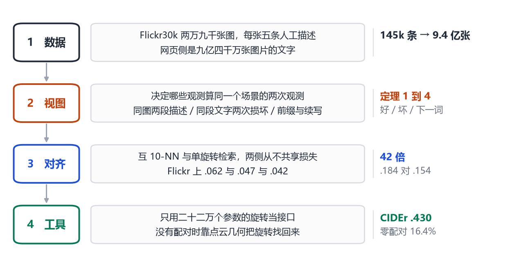
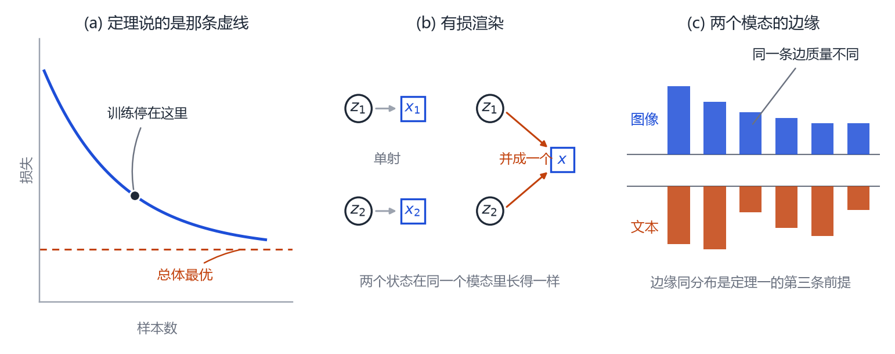

# 第 8 章　证据、反驳与边界

前七章各自交出了一块零件，谱嵌入给出了解的形状，定理一说明共享正样本足以让两个模态只差一个旋转。定理二到定理四分别管住核失配、干扰变量和数据量对世界核的改写，四张定理的每一条前提都指向同一个对象，那个对象叫正样本。读者走到这里最容易犯两种错，一种是拿定理去证明经验结论，另一种是发现经验只是程度问题就判定定理没用。两者犯的是同一个错，都把条件命题与统计事实当成了同一类陈述，而它们的适用条件根本不同。这一章把整条链走一遍，在每一段上标出它承重多少，并交代它在哪里失效。

第 7 章把下一词预测拆成了一个 JEPA，第 6 章把四十二倍写进了一条公式。这一册把它拆成四张定理和一组对照实验，拆完之后它不再是一条可以直接拿去宣传的结论，而是一句条件写在前面、倍数跟在后面的陈述。条件成立时倍数是真的，条件不成立时倍数会缩水，缩到多少取决于视图坏到什么程度，也取决于数据量与谱间隙落在哪里。这一章不引入新的定理，编号沿用前文并与论文原文一致，定理一是柏拉图表征定理，定理二给出核失配的对齐误差界。定理三量化干扰占用的维度，定理四是视图与数据共同决定世界核的结论，命题一到命题四分别管谱解的唯一性、配对数量、好坏视图的区分与下一词预测的形式。

## 8.1　一条链条的四段

整条论证可以画成四段，如图 8-1。数据这一段提供观测，视图这一段决定哪些观测算作同一个场景的两次观测，对齐这一段测量两个独立训练的空间是否落到同一个形状上，工具这一段把对齐的结果当成接口。四段是串联的，前一段的输出是后一段的输入，任何一段失效后面三段的读数都会跟着变，变的方式却不一样。数据不足只让数字变小，视图错了会让数字朝错误的方向变大，两者在曲线上长得完全不同。第一段的数字最实在，Flickr30k 有两万九千张训练图片、每张五条人工描述，网页侧的 Recap-DataComp 提供九亿四千万张图片的文本，每张三条。

<figure class="fig">

<figcaption><b>图 8-1</b>　证据链的四段与各自的读数。左边是数据到工具的流程，右边是每一段上真正量过的数字；第二段决定其余三段的走向，四张定理都约束在这里。</figcaption>
</figure>

第二段是整条链上唯一需要人来决定的地方。给同一张图的两条描述当正样本，得到的核连接场景与场景，给同一段文字的两次随机裁剪当正样本，得到的核连接措辞与措辞。两次裁剪共享的是这段话的说法，而不是它指向的那张图，所以坏视图在拉近两条文本时，拉近的主要是写法。这个区别不进损失函数，它进的是“哪两个东西算一对”这句判断，而这句话是人写的。定理一的条件里因此藏着一次人的决定，在推导里看不出来，在数据管道里一眼就能看到。

第三段的读数由两个不拟合任何参数的指标给出。互 $k$ 近邻在两侧各自找邻居再数交集，随机水平是 $k/N$，一千个样本、十个邻居时是 0.01。单旋转检索先在一千对验证数据上拟合一个正交映射，再用它在测试集上做图到文检索，随机水平 0.1%。前者检验邻域结构是否一致，后者检验这种一致性能不能被一个线性映射利用，两个指标测的东西不同。排序在两者上完全一致，说明排序不是指标造成的，这比任何单个数字都更能支撑结论。

第四段把对齐当成工具。两个空间只差一个旋转，解出这个旋转之后，一个只在文本上训练过的解码器就能描述它没见过的图片，全流程在图文对上拟合过的参数只有那个旋转。768 乘 384 的矩阵扣掉行正交约束，剩下二十二万个数字。同一件事在无配对设定下也成立，靠两团点云的高阶几何把旋转找回来，不需要任何一对配对。一千零一十四对数据拟合出的旋转，在测试集上让 24.6% 的图第一条就取到正确描述，随机旋转只有 0.1% 上下。

## 8.2　同数据同架构只改正样本

一套实验要能支撑因果结论，得让被比较的两组只差一个变量。研究者把数据、架构、目标函数、优化器、批大小、学习率全部按住，只改“哪些文本算同一个场景的两次观测”，差异就只能来自正样本的构造。三组分别是掩码片段、同图两段描述、下一词预测，图像侧始终是同一个 ViT-S/16，两侧没有共享过一个批次，也没有对齐过一次损失。随机初始化那一行给出下限，它是 0.010 的互 10-NN 与 0.001 的 R@1，与随机水平几乎重合。指标没有给任何人送分，也说明后面的数字是从零开始真挣来的。

读数在三条指标上给出同一个排序。同图两段描述拿到 0.062 的互 10-NN、0.044 的 R@1 和 0.133 的 R@5，掩码片段是 0.047 与 0.027 与 0.095，下一词预测是 0.042 与 0.021 与 0.077。换成相对值，好视图比掩码版分别高 32%、63% 和 40%，比下一词版高 48%、110% 和 73%。三个种子的半极差在 0.001 到 0.008 之间，远小于组间差距，排序不是噪声。

有一行数字比这三行都关键。研究者把下一词模型改成每次喂进同一张图的两条描述，让它至少能看见这两句话说的是一回事，结果互 10-NN 从 0.042 挪到 0.043。把配对数据原样送到它面前，它也拿不到好视图的分数，差距不在有没有见过配对数据，而在目标函数把这些数据用成了什么。命题四把这件事写成了形式，损失拆成预测项与配分项，配分项不看标签、只把隐状态从整张词表上推开，解只确定到 $GL(k)$。拿定理二读这组对照，下一词预测诱导的核更接近同一段文字的不同片段，核的差进入分子，误差界随之上抬，掩码片段介于两者之间。

## 8.3　四十二倍与一百零九兆

好视图省样本这件事可以压成一个干净的倍数。同一个 109M 的文本编码器、同一批 Recap 文本，好视图读到两千一百六十万个样本时在 WIT-1024 上到 0.109，下一词预测读到九亿个样本才到 0.111。九亿除以两千一百六十万等于四十二，一个好视图样本要读三条文本，词元数只省十四倍，唯一图片数省四百三十五倍。三个倍数说的是同一件事，词元那一条最保守，也最不容易被算力配置的差异解释掉。两侧用的是各自适合自己规模的配方，四十二倍不是把对手削弱之后得到的。

四条曲线可以用一条式子概括，它把坏视图的底与好视图的增益分开写。前两项随样本数的对数缓慢上升，对数项只在正样本里出现好视图时才起作用，两个杠杆因此落在两项上。式子只有七个参数，形式简单到可以手算，这也是它能当工程预算用的一部分原因。设读过的训练样本数为 $M$、涉及的图片数为 $N$、带好视图的训练条目比例为 $q$，拟合出来的式子是

$$
\mathrm{R@1} = a + d\log M + b\log\!\left(1 + \frac{q^{\alpha} M^{\beta} N^{\gamma}}{c}\right),
$$

式子里 $a,d,b,c,\alpha,\beta,\gamma$ 都是拟合出来的常数，前两项合成坏视图自己也能爬到的那条底。用四十五个格子的结果拟合，均方根误差 0.007，拿它去预测八十五个没跑过的设置，误差 0.0093。同一个设置换一个种子重跑的差别是 0.0096，预测一个没跑过的设置，精度与重跑一次它相当。一条经验公式到了种子噪声的地板，就够格当工程上的预算工具用。

式子里的两个指数值得单独看一眼。沿等对齐线看，样本每多一倍能换掉的 $q$ 是次线性的，$q \propto M^{-0.30}$，好视图可以被数据替代，但替代得很贵。唯一图片数的指数只有 $\gamma = 0.19$，光堆图片而不改善视图作用接近于零，坏视图那一组从四十万张到五千万张图之间始终停在 0.054 到 0.057。这条曲线在远处失效，到三亿两千万样本时它对好视图那几条高估了，因为式子里没有重复数据的项。

把规模放大，好视图的优势不缩反扩。109M 的文本编码器读了九百四十亿张图的文字，在 WIT-1024 上到 0.184，高于 Qwen2.5-72B 的 0.154、Llama-3-70B 的 0.151 和 CLIP 文本编码器的 0.124。线性 CKA 是 0.507 对 0.418，COCO 五千对上是 0.161 对 0.108，换成 CLIP ViT-H/14 当图像侧是 0.230 对 0.210。它读了一千一百六十亿个词元，对手读了一万五千亿到一万八千亿，参数最多大六百六十倍。参数与数据的差距都没有换成对齐的差距，这一条比任何单项指标都更说明目标的效率问题。

无配对的那条线走得比预想远。Schnaus 等人的方法把两团点云各聚成三十簇，先按簇的统计量粗配，再用最优传输逐点精修，全程不看任何一对配对。在 COCO val2014 上 FOSCTTM 压到 0.018，零样本 CIFAR-10 到 86.0%、CIFAR-100 到 67.2%、ImageNet-100 到 64.4%，与重跑的 Qwen3-8B 打平或在两项上超过。Flickr 上的池子小得多，零配对时 16.4% 的测试图第一条就取到正确描述，随机是 0.1%。这说明旋转不是配对数据拟合出来的产物，它本来就在两团点云的形状里。

## 8.4　三条硬限制

第一道限制在总体最优这四个字上。定理陈述的是无穷多数据下最优解长什么样，四张定理都是总体陈述，它们不告诉你梯度下降在有限样本上会走到哪一步。论文自己说得很清楚，唯一性只对二阶反塌缩的目标证明过，LeJEPA 的全分布约束下唯一性仍然是一个假设，因为有限世界撑不出一个精确的高斯。定理二只对谱解证明，而没有任何一次实验严格满足定理一的假设，训练用的是 LeJEPA，图像侧多数还把裁剪当正样本。这三句放在一起，定理的地位就定了，它给的是方向与判据，不是对某次运行的预言。

第二道限制在单射渲染上。嵌入要能分开世界里的状态，前提是每个模态的渲染函数 $g_m$ 是单射，一张照片唯一确定它拍的那个场景。真实模态做不到这一点，一张照片说不全一个场景，两段文字也可能描述同一个场景的不同侧面，“给定观测唯一确定状态”这句话在数据上只是近似。定理二用一种方式覆盖了这种偏离，它把两个核的差放进分子，失配越大界越松。但那只是核失配的界，有损观测的解仍然开放，论文把这一条列在未解里，没有绕过去。

定理二的界值得摆出来看一眼，它把误差与两个可测的量连在一起。左端是配对观测在最佳单旋转之后的均方根距离，右端的分母是谱间隙，分子是两个核的距离。右边没有一项需要知道真实的对齐，全部能从两个核与它们的谱算出来，这是它最实用的地方。设 $\pi_1$ 与 $\pi_2$ 共享边缘 $p$，$\Phi_1$ 与 $\Phi_2$ 是两者的谱嵌入，$\delta$ 取 $K_{\pi_2}$ 的谱间隙 $\mu_k-\mu_{k+1}$，则

$$
\min_{Q\in O(k)}\left(\mathbb{E}_p\lVert \Phi_1(z)-Q\Phi_2(z)\rVert^2\right)^{1/2}
\le \frac{2\sqrt{2}}{\delta}\min\!\left(\sqrt{k}\,\lVert K_{\pi_1}-K_{\pi_2}\rVert_2,\ \lVert K_{\pi_1}-K_{\pi_2}\rVert_F\right).
$$

读这条式子只需要盯两处，$\delta$ 在分母上，分子的两种范数取小。谱间隙越小界越松，这也是簇状世界上的上界几乎没有信息量的原因。分子的取小也不是装饰，失配集中在少数方向时算子范数更紧，摊在很多方向时 Frobenius 范数更省。三百个随机有限世界上界都成立，最坏的一个误差是界的 18%，最好的那些远小于此。界是保命线而不是预报值，它说误差不会超过多少，不说误差实际会是多少。

第三道限制在边缘匹配上。定理一要求所有模态共享同一个正样本分布 $\pi$，其中一步是各模态的边缘都等于 $p$，也就是每个世界状态在每个模态里出现的频率一样。真实数据里图像的边缘与文本的边缘不可能完全相同，拍得多的话题写的人也多，两个分布不会严丝合缝。定理四把这一点放宽成两个诱导核共享边缘 $p$，仍然是一个假设，图 8-2 把三道限制画在了一起。从左到右分别是总体与有限样本的落差、有损渲染把两个状态压成一个观测、两个模态在同一条边上的质量不同。

<figure class="fig">

<figcaption><b>图 8-2</b>　三条硬限制的方向。(a) 定理陈述的是虚线那条总体最优，训练停在实线上的某一点；(b) 有损渲染把两个状态压成一个观测；(c) 两个模态在同一条边上的质量并不相等。</figcaption>
</figure>

三道限制叠起来，用法就清楚了。定理给的不是某个模型一定对齐，而是哪些量决定对齐，那四个量是正样本分布、核失配、谱间隙和干扰占用的维度。它们都能在实验里被改、被估、被拿来做事先判断，看到一个对齐失败，先问是哪一个量出了问题。这比笼统地说表征学习不稳定要有用得多，因为前者给出下一步该动哪个旋钮。前面给的是方向与配方，这一册给的是诊断用的量。

## 8.5　好视图从哪里来

好视图不是免费的。要判断两段文本描述的是同一个场景，本身就用到了场景级的对应关系，Flickr 与 COCO 上这个关系是人工标注给的，每张图五条独立写出来的描述，分组由人完成。这个信息没有进损失函数，却进正样本的定义，于是配对信息从一个后门进来了。从这个后门进来的量比跨模态损失小得多、弱得多，但不是零，这是这一册最容易被略过的一句限定。凡是讨论对齐的结论，都得先问一句这些配对是从哪来的。

网页数据把这个后门换了一个形状。Recap-DataComp 每张图三条文本，一条是替代文本，另外两条由 LLaVA 重写，而 LLaVA 建在 LLaMA-3-8B 上，视觉那头是 CLIP ViT-L/14。于是这两条文本视图里带着从图文训练蒸馏出来的信息，那个三千三百万参数的编码器确实没有见过像素，但它读的文字是见过像素的模型写的。这一层间接性无法消除，只能记住，因为它是数据本身的属性，不是训练目标的属性。要检验它，只能把重写描述换掉，看读数掉多少。

论文自己做了这个对照，把两条重写描述换成替代文本加一条纯文本模型写的复述，复述只读替代文本、不看图。同样二百二十四万张图，WIT 上的互 10-NN 从 0.107 掉到 0.060，检索从 0.339 掉到 0.233，场景解释比例从 0.793 掉到 0.654。落差说明与语言模型、与 CLIP 比规模的那部分结论依赖重写文本。不同视图之间的比较用的是同一批文本，不受这个影响，这是一条把两类结论分开的界线。

这个对照里还有一个更细的读数，它把文本本身的信息量与视图的构造分开。同样的替代文本，好视图 0.060、坏视图 0.055，两组种子不重叠，说明没有图像描述模型参与时好视图仍然略胜。同样的坏视图，两条重写文本到 0.092，替代文本只有 0.055，差距主要来自文本的信息量。把三条路并列起来，配对信息进入系统的入口有三个，正样本的定义、在配对上拟合的那个线性映射、以及 Recap 上由描述模型生成的文本。三个入口都不经过跨模态损失，这一点在方法上是优点，在解释上要打折扣。

## 8.6　图像侧仍然是坏视图

前面所有关于两个好视图的讨论，在实验里只有文本那一侧真正成立。按论文自己的定义，图像编码器的正样本是同一张图的两个裁剪，两次裁剪共享的是这张图的构图、光照与拍摄角度，也就是这个模态自己的干扰。所以除了一处例外，所有图像编码器都是坏视图 JEPA，DINOv2 也是。这一条在定理三的语言里有一个直接后果，编码器会把一部分维度花在这张图特有的东西上，那部分维度对不齐，也收不回来。因此“两侧都是好视图”这个前提，在真实实验里从来没有被完整检验过。

那个例外是视频。均匀取八帧、各自过编码器、把八个向量取平均，这一串操作在 MSR-VTT 上拿到 0.246 的 CIDEr，落在零样本描述器与专门训练的视频语言系统中间。更重要的是它对对齐的影响，一帧是一个场景的一次观测，八帧平均把这些帧各自的干扰抵掉。片段与描述的互 10-NN 从单取中间帧的 0.148 升到 0.167，这是定理三的推论在真实数据上少见的直接体现。

图像对图像的对照把这个缺口照得更亮。同一批图，Flickr 上自训的图像 JEPA 与 DINOv2 之间互 10-NN 只有 0.101，而文本侧那个三千三百万参数的编码器对 DINOv2 有 0.232。图像对图像本该更容易对齐，读数反而更低，原因在于那个图像模型太小、见得太少，它和 DINOv2 的差异比文本侧更大。互 10-NN 不是对齐百分比，它的绝对尺度取决于两侧各离理想表征有多远，能横向比较的只有同一张表里的行。还有一条不平等的条件要交代，超参数只为好视图那一组调过，另外两组用的是同一套配方。

要把这条质疑彻底排除，得让每组各自调到最好再比，那样做很贵，论文没有做。读者应当把它记成一条尚未排除的替代解释，而不是当成可以忽略的细节，因为它影响的正是结论的方向。“好视图更好”这个说法里，有多少来自正样本，有多少来自调参，现在还没有分开。这一条不影响定理的成立，只影响实验的强度，两者要分开评价。

## 8.7　缺口与分工

定理说的是任意多个模态，只要它们观测同一个世界、共享同一组正样本。实验做的是图像与文本，加上视频的一点延伸，音频、动作、触觉都还没有大规模验证。音频看起来最接近，一段环境声与它对应的视频是同一个场景的两次观测，正样本容易定义。触觉更远，能采到的数据少，传感器之间的标定也不统一，跨设备对齐本身就是一个问题。这两个模态离得越远，越说明定理的适用范围是被数据卡住的，不是被证明卡住的。

动作最难，难在正样本的定义而不是数据量。什么算同一个场景下的两次操作，两个机械臂在同一张桌子上做同一件事算不算，同一个机械臂换个角度再抓一次算不算。这些问题在图像上可以由人指着说这两张是同一个地方，在动作上没有对应的指法。定义不清楚，好视图就无从谈起，定理四也就无从应用，因为诱导世界核这件事完全依赖正样本把哪些状态连起来。这一条是覆盖面里最实的缺口，也是第 8.8 节第一条方向要解决的对象。

与生成式路线的关系值得摆清楚，两者解决的不是同一类需求。要把一段视频接着生成下去、把一张图补全，需要像素级的生成模型，Genie 那类交互式环境模型与 Dreamer 那类想象式世界模型都在做这件事。要判断两个表征是不是同一张地图、能不能只用一个旋转接起来，需要把世界压成几何的编码器，JEPA 的价值在这里。它不生成像素，它给出可以比较的距离和一个参数极少的接口。中间还有第三种需求，可造数据，生成模型能造出训练集里没有的场景，而生成出来的场景要当正样本，仍然得知道哪两个观测属于它。

## 8.8　三个方向

好视图往视频与动作扩，是第一条。视频的正样本可以是同一段视频的两个时间片，这类数据现成，不需要额外标注，八帧平均在 MSR-VTT 上已经露出一点效果。动作要难得多，得靠机器人或模拟器采集，还要先把同一个场景的两次操作定义清楚。这一步走出去，定理才从两模态的验证变成多模态的验证，也才谈得上任意 $M$ 个模态那句话。

JEPA 与语言模型结合，是第二条。这一册里的解码器已经是一个雏形，语言模型只当解码器，把三百八十四维的向量翻成句子，不负责理解世界。LLM-JEPA 一类工作走得更远，把语言模型的隐状态直接当表征来预测，让预训练好的语言能力进入目标函数。哪一头该固定、哪一头该训练，现在还没有定论，但方向是清楚的，语言那一侧的规模不该被浪费在只做下一词预测上。

第三条是把对齐压缩成一个旋转，当成多模态系统的默认假设。现在的做法是先攒配对再联合训练，代价从几十万对到几亿对，如果两个编码器各自在自己的模态上训练干净，最终只需要二十二万个参数接起来。数据不必配对，模型不必共享，接口是一个旋转，多模态系统的工程形状会因此改变。这条假设什么时候能用、什么时候会把错误藏起来，第 8.4 节那三道限制就是判据。

回到全书开头那个问题，不同的模型是不是在画同一张地图。第 1 章那批观察说的是模型越大表征越像，但那只是一个统计事实，说不出为什么，也说不出到哪里为止。这一册给出的答案分两半，一半是条件命题，如果正样本是同一个场景的两次观测，那么各自的总体最优解只差一个旋转。另一半是边界，总体与有限样本之间、单射与有损之间、共享边缘与真实数据之间各有一段距离。那段距离就是经验结果只能停在程度上的原因，也是这一册把定理与实验分开写的理由。

地图不是领土，这句话到这里有了具体的形状。两个编码器各自画了一张地图，比例尺不同，坐标系不同，把其中一张转过去，路口的相对位置对得上。对得上这件事本身是关于世界的一个事实，它很难从两个毫不相干的数据集里碰巧出现。二十二万个数字装不下世界，装下的是两个空间之间的一个角度，这个角度出现的位置很稳定，换数据、换编码器、换模态，它还在那里。

接下来要做的事有两件。一件是把这个角度量得更准，让对齐的残差继续往下走，让好视图从人工分组走向自动判断。另一件是把它带到还没有人验证过的模态上去，音频、动作、触觉，哪里能定义出好视图，定理就在哪里能用。两件都不容易，但都比把模型再放大十倍更接近问题的根，地图画到这一步，剩下的是把每一段边界都摸一遍。
