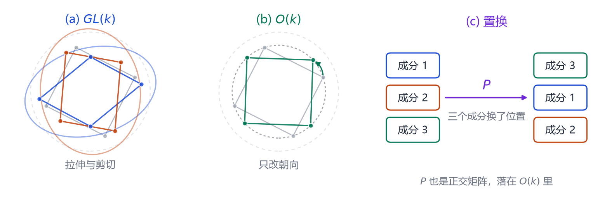
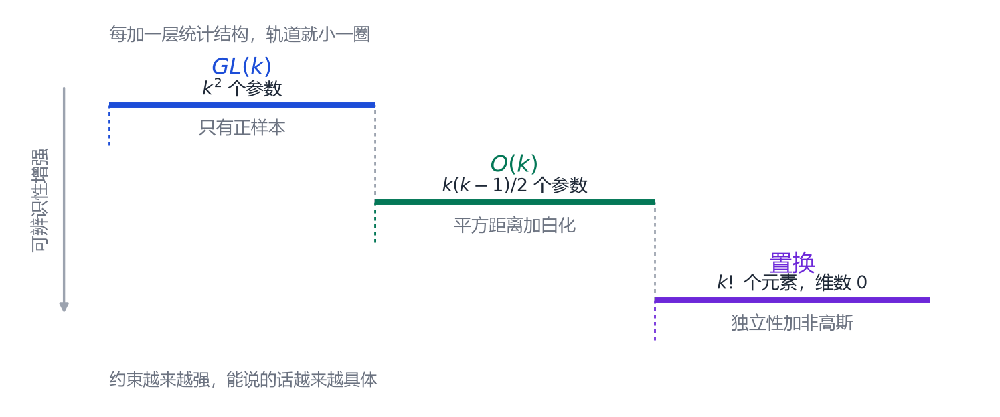
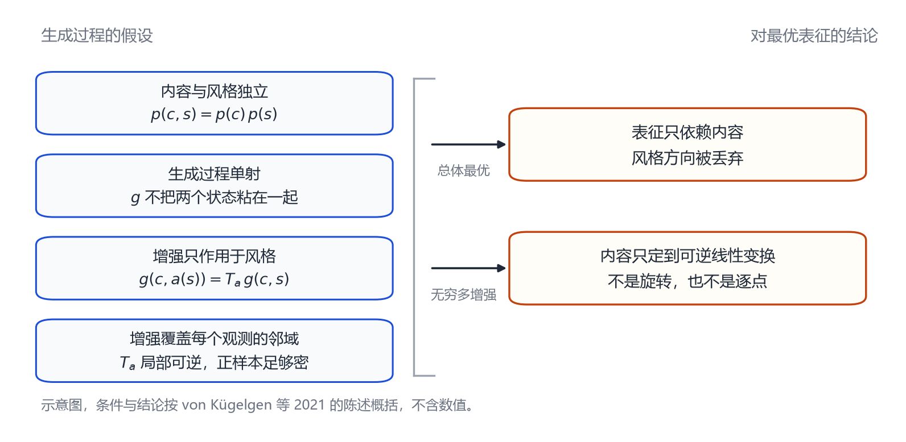
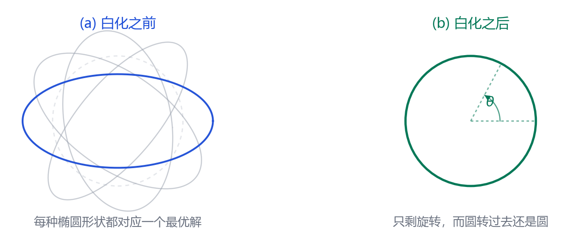

# 第 8 章　识别性与可辨识

同一张桌子，三个人量出来的数不一样。一个人用厘米，读到一百二十；一个人用英寸，读到四十七；第三个人用手掌的宽度，读到六。三份记录没有一个数相同，可它们说的是同一张桌子，只要把各自的单位换算过去，桌子就重合了。换算在数学上就是乘一个正数，而在更复杂的情形里，它是一个矩阵、一个旋转，或者一次坐标重排。问题在于，光看记录本身，能不能把那个换算找出来，找出来之后还剩多少不确定。这个问法就是可辨识性（identifiability），它是本章唯一的话题。

把这件事写成式子会清楚一些。一个模型族把参数 $\theta$ 映到观测上的分布 $p_\theta$，训练做的事情是从数据里挑一个 $\theta$ 回来。若两个不同的参数给出完全相同的分布，也就是 $p_{\theta_1}=p_{\theta_2}$ 而 $\theta_1\ne\theta_2$，那么任何只看数据的办法都无法把它们分开，这样的一对参数就叫不可辨识。桌子那个例子里，参数是单位，分布是记录，换单位不改变桌子的大小，于是所有单位被归成一类。可辨识性问的不是"训练得好不好"，而是"从数据到参数这条路是不是单行道"。

前七章的结论都写成同一个形式，也就是解被确定到某个变换群。定理一说两个模态的最优解只差一个旋转，命题一说谱 JEPA 的最小值点恰是 $Q\Phi_\pi$ 这条轨道，命题四说下一词预测只定到一个可逆线性变换。这些句子读起来像在讲误差，实际上讲的是解集的形状，而形状由一个群说了算。一个群越大，落在同一条轨道上的解就越多，你能从解里读出的东西就越少，所以"可辨识到什么程度"与"群的直径多大"是同一句话的两种说法。

本章把这个形式本身拆开。先给定义，把参数不唯一与观测等价类这两件事说清楚；再排三种常见的群，看它们各自对应哪一类训练目标。然后读对比学习那条线上已有的结果，看它把解定到了哪里；接着解释白化为什么是拿到正交的那一步；收尾回到定理一，说明它的分量到底从哪里来。第 7 章末尾把证据链与三条限制留给了后面的章节，在走到那里之前，这块地基本来就该先补上。

## 8.1　什么叫可辨识

严格的定义要分强弱，因为"能不能识别"几乎从来不成立或完全不成立这两种情形。最弱的一档叫弱可辨识，它只要求把等价类刻画出来，也就是告诉你"所有与真值不可分辨的参数长什么样"，而不要求在类里挑一个。最强的一档叫强可辨识，它要求等价类只有一个点，从数据出发能唯一地反推出参数。中间还有一档叫块可辨识，它只识别参数的一部分坐标，剩下的那部分随它去。三种强度对应三种工程承诺，写在论文里的通常是第一档或第三档，读者若按第二档去理解，就会觉得结论太软。

等价类这个词值得先钉住，因为后面所有的强弱之分都建立在它上面，而它指的是能产生同一个观测分布的那一整批参数。给定观测分布 $p$，凡是能产生它的参数都算与它相容，收在一起记作

$$
[\theta]=\{\theta' : p_{\theta'}=p\},
$$

这个集合就是 $\theta$ 的观测等价类，成员之间在数据层面完全不可分辨，因为在任何一个可测集上它们给出的概率都一样，任何一个基于似然的统计量也给出同一个数。可辨识性于是有了精确的说法，说的是这个集合的大小，而不是某个估计量准不准。用集合而不是用误差来讲，好处是它不依赖优化算法，也不依赖样本量，纯粹是模型族的性质。代价是这个说法只管存在性，不管能不能找到，找得到找不到属于估计问题，两者要分开谈。

到了表征这一层，等价类换了一身衣服。编码器 $f$ 把观测映到 $\mathbb{R}^k$，两个编码器 $f$ 与 $f'$ 被称为等价，如果存在一个变换 $T$ 使 $f'=T\circ f$ 逐点成立。这里没有要求 $T$ 是线性的，也没有要求它可逆，$T$ 的形状决定了这一层等价关系有多粗。若 $T$ 取遍所有双射，等价类大到没有内容，任何两个维度相同的编码器都等价，可辨识性归零；所以真正有信息的问题是，在具体的损失函数下 $T$ 被迫落在哪个子群里。

块可辨识是这套语言里最实用的一档，因为真实数据的因子从来不是平等的。一个观测由内容与风格共同决定，内容是要的那个，风格是随场景变的那个，块可辨识说的是表征可以分成两块，第一块只依赖内容且把内容识别到一个线性变换，第二块容纳风格，两者之间不混。这个结论比强可辨识弱，却比"什么都没识别出来"强得多，因为它保证了内容的信息全部落在指定的那几个坐标上，风格不会渗进去。本章后面要读的对比学习结果正是这一档。

要理解为什么目标函数只能给出等价类，把损失写开就够了。JEPA 的损失是 $\mathbb{E}_{\pi}\ell\big(h(z),h(z')\big)+\Omega(h)$，$\ell$ 只看两个嵌入之间的差，$\Omega$ 只看嵌入的分布，两者都不看 $h$ 的坐标怎么写。若把 $h$ 换成 $T\circ h$ 而 $T$ 逐点保持 $\ell$，损失一个数都不动，$T\circ h$ 就自动是最优解。换句话说，解集之所以是一条轨道，不是因为训练没做好，而是因为目标函数对 $T$ 的作用完全无感。这条观察是全部可辨识性讨论的起点，因为后面每一个群都是从这个无感里算出来的。

从这个角度看，可辨识性不是一个需要额外争取的性质，而是需要额外压缩的集合。目标函数给了你一个解集，可辨识性问的是这个集合还能不能再小，而压缩它的唯一办法是加约束，或者换一类损失。约束加在什么地方，解集就缩在什么地方，本章后面几节都在算这笔账。用一句话概括，你能识别什么，取决于你在目标函数之外还知道什么，而这句话在后面每一节都会以不同的形式再出现一次。

可辨识与可估计是两件事，前者是模型族的性质，后者是估计量的性质。一个参数可以被识别，却可能估得很差，因为它的影响被噪声淹没，或者样本量不够；反过来，一个不可辨识的参数可以被估得很稳，只要估计量在各次抽样里总落在轨道上的同一个位置，而这种稳定是虚假的，换个初始值就跳走。区分这两件事的实用价值在于，模型不收敛时你要先问属于哪一类问题，问清楚之后修的地方完全不同，前者要改模型或加约束，后者要改优化或加数据。混着问的最常见后果是把一个结构问题当成调参问题，越调越远。

规范固定（gauge fixing）是这套语言里的一个操作名词。既然解集是一条轨道，那么写报告时总得挑一个代表元，挑法就是一种约定，与数据无关。坐标轴的单位、地图的北、PCA 里特征向量的正负号，都是规范固定。约定本身没有对错，但它有一个后果，就是下一次换一批数据重训练时，代表元可能跳到轨道的另一个位置，于是两次训练的坐标对不上。把这种跳动当成模型不稳定，是常见的误判，它其实是轨道在动，几何没动。

## 8.2　三种等价关系

第一个群是可逆线性群 $GL(k)$，7.5 节已经算过它的来历。下一词预测的预测项是内积 $-\langle h,w_v\rangle$，$h$ 与 $w_v$ 同时变换时内积不变，把 $h$ 换成 $Gh$、$w_v$ 换成 $G^{-\top}w_v$，所有 logit 一个不动，条件分布也一个不动。$G$ 只需要可逆，不需要别的，于是解只能定到 $GL(k)$。这个群的自由度是 $k^2$，它包含了拉伸、剪切、旋转、反射，以及它们的任意复合，凡是不把空间压塌的线性变形都在里面。

第二个群是正交群 $O(k)$，它来自两个条件同时成立。预测项取平方距离 $\lVert a-b\rVert^2$ 时，只有等距变换能让损失逐点不变；反塌缩项取白化硬约束时，可行集被限制在二阶矩等于单位阵的那一片上。两者的交集就是 $O(k)$。定理一与命题一说的"只差一个旋转"用的正是这个群，它的自由度是 $k(k-1)/2$，比 $GL(k)$ 少了一大截，差出来的 $k(k+1)/2$ 恰好是对称正定矩阵的维数，也就是极分解里那个拉伸因子 $P$ 的全部自由度。

第三个群是置换群 $S_k$，它比前两个都小，却不是一个连续群。它的成员是把坐标重新编号的置换矩阵，一共有 $k!$ 个，维数为零。置换出现在目标函数对每个坐标一视同仁的时候，比如反塌缩项逐坐标分开写、预测项逐坐标分开写，坐标之间没有任何交叉项，那么把两个坐标整体对调，损失一个数都不变。独立成分分析的目标函数就长这样，它要每个成分各自独立，独立这件事对成分的排列没有偏好，于是排列成了不可辨识的部分。

三个群的包含关系是 $S_k\subset O(k)\subset GL(k)$，因为置换矩阵满足 $P^\top P=I$，正交矩阵当然可逆。这个链条可以直接读成可辨识性的强弱，越往右群越大，轨道越粗，能读出的东西越少。反之越往左越细，$S_k$ 的轨道只有 $k!$ 个点，落在这条轨道上的解彼此只差一次编号。把三种情形画在同一张图上，差别就很直观，如图 8-1，左边是可逆线性作用下的同一个四边形，形状被拉成好几种，中间是正交作用下的同一个四边形，只是转了角度，右边是三个成分换了位置而含义不变。

<figure class="fig">

<figcaption><b>图 8-1</b>　三种等价类的几何。同一个四边形在 $GL(k)$ 下被拉成不同形状而损失不变，在 $O(k)$ 下只改朝向，置换则只改成分的编号，三者依次变细。</figcaption>
</figure>

置换这一档有一个容易被忽略的细节，它的维数是零，但它的成员数随 $k$ 增长得极快。$k=8$ 时 $8!=40320$，比 $GL(8)$ 的 $8^2=64$ 个参数多出三个数量级。所以说置换最可辨识，只在"连续自由度为零"这个意义上成立，它剩下的是一堆离散的副本，副本之间有穷多个，不会随数据增加而消失。要把这些副本也压掉，必须再知道哪个成分对应哪个物理量，而那已经是标签的活，不是自监督能给的。

如图 8-2，三种情形排成一个阶梯，阶梯的每一级都标着它额外用掉的统计结构。最上一级只有正样本可用，什么东西都没有约束，解停在 $GL(k)$。中间一级加上了二阶矩，也就是白化，解缩到 $O(k)$；最下一级再加高阶矩，也就是成分之间的独立性，解缩到置换。阶梯的横轴不是时间，也不是模型规模，而是"你额外知道了什么"，这一点值得反复提醒，因为工程上最常见的错误是把规模当成可辨识性的来源。

<figure class="fig">

<figcaption><b>图 8-2</b>　识别性阶梯。从只有正样本到白化再到独立性假设，剩下的是 $GL(k)$、$O(k)$ 与置换，各自的参数个数标在台阶上，置换那一级是离散群。</figcaption>
</figure>

把群作用写出来，可辨识性就有了一个几何名字。参数空间被群的轨道切成一堆不相交的块，同一块里的参数给出同一个分布，于是从数据出发能确定的东西只有块本身，也就是轨道空间里的一个点。可辨识性强，意思是轨道细，轨道空间接近原空间；可辨识性弱，意思是轨道粗，轨道空间被压成一个低维的商空间。这个说法把能识别什么换成了商空间有多大，而商空间的大小可以直接算，等于原空间的维数减去群的维数，$GL(k)$ 减掉 $k^2$，$O(k)$ 减掉 $k(k-1)/2$，置换只减掉离散的几个点。

把这三条放在一起，可以抽出一条一般原理，就是训练目标对哪个群不变，那个群就留在解集里。这不是一条需要证明的定理，它是"不变性"这个词的定义，但它在实践里非常有用，因为它把"我的模型能识别什么"变成了一个可以查的清单。你只需要问两件事，损失对哪些变换无感，约束在哪些变换下仍然成立，两者的交集就是你的可辨识性上限。下一节要读的那条结果，正是用这个办法算出来的。

## 8.3　对比学习给出的可辨识性

对比学习这条线上的可辨识性研究，起点是一个很实际的问题。数据里真正决定语义的因子（内容）与随场景变化的因子（风格）混在一起，观测是两者的联合渲染，而训练只给正样本，不给任何因子标签。凭什么相信学到的表征把内容与风格分开了？von Kügelgen 等人在 2021 年给出了一个答案，做法是把数据生成过程写清楚，再证明 InfoNCE 损失（information noise-contrastive estimation）的总体最优在什么条件下只依赖内容。

他们的设定是这样的。每个观测由内容 $c$ 与风格 $s$ 渲染而成，写成 $x=g(c,s)$，其中 $g$ 是生成过程；内容与风格独立，也就是 $p(c,s)=p(c)p(s)$。$g$ 是单射，不同的内容风格对不会被渲染成同一个观测；数据增强 $A$ 只作用于风格，在观测空间里写成 $g(c,a(s))=T_a\,g(c,s)$，$a$ 是风格空间里的一次光滑变换。这些条件把"增强不改语义"这句工程直觉写成了代数，其中单射这一条与本书引理 1 的假设是同一个东西，它保证观测不丢状态。

第四条条件比前三条容易被漏掉，它管的是增强的覆盖范围。对每个观测，增强后的样本必须在它周围足够密，密到能覆盖一个邻域，并且 $T_a$ 在局部可逆。这一条的作用是保证负样本足够多，InfoNCE 的配分项才有约束力，否则一批里只有几个彼此相近的样本，模型只要把这一小批拉开就能让损失下降，风格会原样留在表征里。与之配套的还有一个总量条件，就是每个观测可用的增强样本数不受限，等价于说增强分布是一个连续分布而不是有限次抽样。

在这四条之下，结论可以分两句读：第一句是表征 $r^\star$ 只依赖内容，也就是 $r^\star(x)$ 在风格方向上不变，风格被完整丢弃；第二句是内容被块识别到一个可逆线性变换，内容的信息一点没丢，但写法不唯一，同一个内容可以用 $A c$ 的任意可逆像来表示。两句合起来就是块可辨识，内容那一块被识别到 $GL$ 里的一个元素，风格那一块被清空，而这个结论的力量在于它不假设生成过程是线性的，$g$ 可以是任意光滑单射。

四条假设各自都是必需的，这一点可以从它们各自失效时的样子看出来。若内容与风格不独立，风格里就带着内容的信息，模型可以靠风格反推内容，两个因子在表征里继续纠缠；若 $g$ 不是单射，两个不同的内容被渲染成同一个观测，任何从观测出发的办法都无法把它们分开，这与 3.4 节讲的有损渲染是同一种病。若增强改动了内容，模型为了在正样本对上保持一致，只能把内容也一起丢掉，塌缩随之而来；若增强覆盖不够，配分项约束不到风格方向，风格就留下来。四条各管一处，缺一条结论就掉一档，而掉的那一档恰好对应 8.2 那张清单里的一个台阶，这也是为什么后来的工作总要逐条检查它们。

与本书的定理一相比，这条结果有两个结构性差别，值得说清楚，因为它们常被混为一谈。差别一在训练方式，von Kügelgen 等人训的是单个编码器，正样本来自同一样本的不同增强，而定理一训的是多个编码器，各自看一种模态，彼此的数据不相交，共享的只有正样本的定义。差别二在假设的对象，他们假设生成过程有一个内容与风格的分解，这是关于世界结构的强假设，定理一只假设渲染单射与正样本相同，不假设世界分成两块。两条路线的结论因此不能互相替代。

内容与风格独立这条假设，在真实数据上最容易失效，因为相关常常是采集过程的副产物。同一批照片里，高档餐厅总是暖光，室外场景总是阴天，风格与内容在样本层面高度相关，独立性只在总体意义上成立，而样本把它打破了。打破的后果不是结论直接错，而是结论退化成一条带误差的近似，误差的大小由条件互信息决定，也就是风格能告诉你多少关于内容的信息。工程上能做的是把采集过程做得更均衡，或者把风格的定义收窄到只含几何变换，后者正是大多数数据增强在做的事。

还有一处差别在结论的强度上，这处差别正是本章的主线。他们得到的是可逆线性，不是正交，因为 InfoNCE 的预测项是内积形式的相似度，配分项也不含二阶矩约束，两个条件里只有"旋转不变"这一半在场，白化那一半缺席。按 8.2 的清单去查，缺失的条件对应缺失的群，结论停在 $GL$ 上是必然的。这也解释了为什么后来的工作要在对比损失上加白化或方差正则，加了之后才能把结论推到正交，7.5 节算过的那笔自由度账在这里又出现了一次。

如图 8-3，左列的四条假设与右列的两句结论是一一支撑的关系。箭头下面还标了两个总量条件，总体最优与无穷多增强。这张图故意不给数值，因为它描述的是一个条件命题的形状，而不是一次实验的结果。读者若想把它当成检查表用，办法是逐条问自己手里的数据满足几条，再看结论该打几折，而不是直接引用末了那句"内容可识别"。

<figure class="fig">

<figcaption><b>图 8-3</b>　可辨识性结论的条件与结论对照。左列四条假设分别管独立性、信息不丢失、增强的作用范围与负样本的密度，右列两句结论是表征只依赖内容、内容只定到可逆线性变换。</figcaption>
</figure>

这里还要提一句多模态版本。Daunhawer 等人在 2023 年把可辨识性结果推到了联合训练的两个模态上，结论是共享的因子被识别、模态私有的因子被分离，前提同样是生成过程有明确的结构，并且两个模态被放在同一个目标里一起训练。本书定理一走的是另一条路，两个模态分别训练，谁也不看谁的数据，靠共享的正样本在事后对齐。两条路的假设不一样，能说的话也不一样，混着引用会让结论看起来比实际强。

## 8.4　白化与正交约束

现在回答一个前面一直悬着的问题，命题一里为什么恰好是 $O(k)$，而不是 $GL(k)$，也不是某个更大的群。答案由两半拼成，一半来自损失，一半来自约束，两半各自都能单独算清楚。两半各只有一行推导，谁出了错一眼就能看出来。把这两半分开算的好处是，以后换损失或换约束时，你知道该改哪一半，也知道改完之后群会变成什么。

损失这一半是一行代数，设 $G$ 是线性变换，要求 $\lVert Gv\rVert^2=\lVert v\rVert^2$ 对所有 $v$ 成立，把两边写成 $v^\top G^\top Gv=v^\top v$ 就得到 $G^\top G=I$，也就是 $G$ 正交。所以平方距离这个预测项的等距群恰好是 $O(k)$，一个不多一个不少。若预测项换成内积，它约束的不再是一个差向量，而是两个向量之间的搭配，$h$ 与 $w$ 可以各自被一个可逆矩阵作用，只要两个矩阵互逆，内积就一个数不动。$G^\top G=I$ 这条限制随之消失，结论是整个 $GL(k)$，7.5 节正是这么算的。

约束这一半同样是一行，白化要求 $\mathbb{E}_p hh^\top=I_k$ 而 $h'=Gh$ 也满足同一条，于是 $\mathbb{E}_p h'h'^\top=G(\mathbb{E}_p hh^\top)G^\top=GG^\top=I$，满足这个条件的矩阵正是正交矩阵。于是"保持白化"这件事本身就把线性自由度压到了 $O(k)$，这一步既不需要关于数据的假设，也不需要关于损失形式的假设。

两半给出同一个答案，这不是巧合。白化把可行集从一整片开集缩成一张曲面，平方距离把损失在这张曲面上的等值线画成同心圆，两者的对称群于是重合。换个说法，白化负责让你没法靠缩放把损失做小，等距性负责让你没法靠剪切把损失做小，两条各堵一条路，剩下的就只有旋转。如图 8-4，可行解集的形状在白化前后差得很远，左边没有白化时每一个椭圆都对应一个最优解，形状随你挑，右边加了白化之后只剩下圆，而圆转过去还是圆。

<figure class="fig">

<figcaption><b>图 8-4</b>　白化前后可行解集的变化。左图的椭圆各有各的形状，每一种都对应一个最优解；右图的约束把二阶矩钉成单位阵，解集收成一个圆，只剩旋转这一个自由度。</figcaption>
</figure>

反过来的两个方向也要说，因为工程上的失败大多走的是这两条路。第一条是损失用了内积、约束用了白化，这时损失那一半不提供任何限制，白化那一半只能压住 $GG^\top$，而 7.5 节的内积不变性允许 $G$ 与 $G^{-\top}$ 成对出现，$G$ 本身可以任意可逆，于是解集仍在 $GL(k)$。第二条是损失用了平方距离、约束只给了方差下界而没有去相关，这时可行集是一片开集而不是一张流形，最小值可能取不到，解集里还留着缩放方向。最终落到哪一点取决于优化器的路径。

白化在实现上有软硬两种写法，两种给出的群不完全相同。硬写法把 $\mathbb{E}_phh^\top=I_k$ 当成约束，每一步都把嵌入投影回那张曲面上，可行集精确地是 $O(k)$ 的一条轨道；软写法把它写进损失，比如 VICReg 的方差与协方差两项，或者 Barlow Twins 的对角与非对角两项，这时约束只在最优点附近近似成立，解集是轨道的一个邻域而不是轨道本身。邻域的大小由罚系数定，罚得轻，邻域就宽，跨模态比较的残差里就混着本该被压掉的剪切与缩放。软写法在实践中更常用，因为它不打断梯度，代价是可辨识性变成渐近的，写论文时要交代清楚罚系数趋大这一步。

把这几条放在一起看，可辨识性不是某一个部件单独给的，它是损失与约束的乘积。工程上常见的做法是加一个白化层，同时在损失里用余弦相似度，这两个选择各自只提供一半，合起来才给出正交。若只加其中一个，你会看到训练很稳、指标也不错，可一旦要做跨模态比较，距离与夹角立刻失去意义，因为解集还在 $GL(k)$ 上。这也是为什么把白化层摸掉之后，余弦相似度单独用起来会显得那么靠不住。

$O(k)$ 内部还有一层结构，值得单独说。置换矩阵 $P$ 满足 $PP^\top=I$，所以 $S_k$ 整个落在 $O(k)$ 里，白化看不见它，平方距离也看不见它。这意味着"只差一个旋转"这句话里其实包含了"只差一次编号"，两者在二阶统计上是同一件事。要把编号也定下来，必须动用三阶或更高的统计量，也就是分布的非高斯性，这正是下一节要讲的独立成分分析做的事。

数字上看一眼会更实在。取 $k=768$，这是书中反复出现的嵌入宽度，$GL(k)$ 有 $768^2=589824$ 个参数，$O(k)$ 有 $768\times767/2=294528$ 个，两者相差 $768\times769/2=295296$ 个，正好是对称正定矩阵的维数。这个差值不是抽象的大小，它是"从可逆线性降到正交"这一步省掉的不确定性。它也是 3.10 节里正交约束为什么能让结果迁移到没见过的图像上的原因。

## 8.5　与独立成分分析、流形学习的关系

独立成分分析（independent component analysis，ICA）是这条线上最早也最干净的一支。它假设观测是若干独立非高斯成分的线性混合，$x=As$，目标是找一个解混矩阵 $W$，使 $y=Wx$ 的各分量尽可能独立。可辨识性结论是 $WA=PD$，$P$ 是置换矩阵，$D$ 是对角缩放矩阵。这个结论的形状与 8.2 的阶梯正好对上，置换加缩放正是"独立"这个要求能定到的位置，它比正交更细，因为分量被逐个挑了出来。

ICA 与谱方法的差别可以精确地指出来。谱方法只用二阶矩，白化之后停在 $O(k)$，因为在高斯世界里二阶矩就是全部信息，任何两个白化过的分布都能被一个旋转对上。ICA 用高阶矩，非高斯性让旋转也变得可辨，因为旋转会改变边缘分布的形状，而独立性要求边缘分布恰好是那个形状。换成本章的语言，ICA 用更高的统计阶数换来了更小的等价群，代价是它必须假设成分独立且非高斯，这两条在真实数据上都不是白来的。

非高斯性为什么能打破旋转，用两个一维分布就能看清。取两个独立的均匀分布，混合之后落在正方形上，白化之后仍是正方形；把它转四十五度，形状变成菱形，分布跟着变了，于是旋转可以被认出来。若两个成分都是高斯，白化之后是圆，怎么转都一样，ICA 在这里彻底失效，这条对照就是它为什么必须假设非高斯。换成统计量的语言，高阶矩提供的信息是分布的形状，而形状只在非高斯时才在旋转下露出痕迹。

流形学习是另一支，它的假设换了个方向。Isomap 与拉普拉斯特征映射假设数据落在一个低维流形上，恢复的是流形上的距离或局部邻域结构，可辨识性只在等距意义下成立，也就是任何保持流形上距离的映射都给出同样好的解。这个群比 $O(k)$ 大得多，它包含所有等距嵌入，旋转只是其中最容易写出来的那一类。所以"谱方法只差一个旋转"这句话成立的场合，比"流形学习能恢复几何"这句话成立的场合要窄。

两支的关系在本书里有一个精确的落点。命题一的解 $\Phi_\pi(z)=(v_1(z),\dots,v_k(z))/\sqrt{p(z)}$ 是图核前 $k$ 个特征函数按 $\sqrt{p}$ 归一之后的样子，论文把它称为拉普拉斯特征映射的总体形式。这句话的意思是，谱 JEPA 学到的东西与流形学习学到的同属一类，差别只在加权与约束，前者按 $p$ 加权并强制白化，后者按度加权。既然同属一类，流形学习那层等距不确定性就原样继承过来，$O(k)$ 里的旋转与置换都在。

把三支并排看，可以按"用了几阶统计量"排一个序。只用正样本与平方距离，解停在等距群；加上二阶矩的白化，解缩到 $O(k)$；再加上高阶矩的独立性，解缩到置换与缩放。这个序与 8.2 的阶梯是同一张表，只是横轴换了个名字。用几阶统计量，就等于问"你相信数据分布到什么程度"，相信得越多，能定下来的越多，代价是假设也越强。

## 8.6　可辨识性作为定理一的地基

回到定理一，它的结论是 $f_m^\star\circ g_m=Q_mh^\star$，$Q_m\in O(k)$，这句话的强度完全取决于前件里"唯一到旋转"这一条由谁供给。供给它的是命题一，而命题一的结论又完全取决于白化与平方距离这两个设定。换句话说，定理一能说"只差一个旋转"，是因为它的解集已经被压到了 $O(k)$，压的过程不在定理一里，在这一章里。这条链上每一环都由不同的命题供给，缺一环结论就断在哪里。

若把这一步抽掉，定理一会变成什么样子，值得推一遍。假设解只定到 $GL(k)$，那么定理一的结论就要改写成"两个模态的最优解只差一个可逆线性变换"，而这句话几乎没有内容，因为任意两批处于一般位置的向量之间总能找到一个可逆线性变换把它们对上。检验也随之失效，你拿一对模型去量对齐，量出来的残差恒为零，零残差既不能证实也不能证伪任何东西。可辨识性在这里起的作用，是把一个恒真的句子换成一个可能为假的句子。

3.10 节那组对照是这件事的实验版本。同一个文本侧、同一批 30k 配对，只把映射从行正交换成无约束线性，Flickr 上 CIDEr 从 .504 升到 .531，COCO 上从 .802 掉到 .635，两层 MLP 更差，.498 与 .585。这个模式很说明问题，无约束的映射在拟合的那一侧略微更准，换到没见过的分布上就垮掉，因为它拟合的是这一批配对的偶然结构，而不是两个嵌入之间那个稳定的关系。正交这个约束让拟合变难，却让结论变成可迁移的。

有三个词在这条线上经常被混用，值得分开。可辨识性讲的是解集，说的是目标函数的最优解能被确定到哪个群；对齐讲的是两个解之间的关系，说的是它们的相对变换落在哪个群里；对齐质量讲的是估计，说的是有限样本下算出来的相对变换离总体值有多远。三者可以独立变化，一个可辨识的问题可以有很差的对齐质量，一个不可辨识的问题也可以有很稳的对齐分数。分开的好处是实验报告里的数字终于有了归属，它属于第三层，不能拿去支持第一层的结论。

所以可辨识性不是一个技术细节，它是"对齐"这个词有意义的前提。两个模态的嵌入若能相差任意可逆线性变换，说它们对齐就是自欺。只有当解集小到只剩旋转，比较才携带信息，普罗克鲁斯提斯才能把那个旋转定死，残差才能当成一个可以被解释的量。定理一给出的是这个结论的形式，本章给出的是它凭什么成立，两者合起来才构成一句完整的话。

这条地基还有一个副产品，就是把"该测什么"变成了一张清单。可辨识性弱在哪个群上，就该在哪个群上做校准，$GL(k)$ 的情形要拟合线性映射，$O(k)$ 的情形只需拟合旋转，置换的情形则要做匹配。校准方式选错，残差里混进的就是群的那部分自由度而不是模型之间的真实差异。第 1 章那三个度量在置换校准前后的排序变化走的是同一条逻辑。

剩下的问题是这些结论在有限样本下还能剩多少，因为命题一与定理一说的都是总体最优。那里 $\pi$ 与 $p$ 精确已知，白化精确成立，谱间隙不为零，四样都不带误差。真实训练里这四样都是估出来的，核是经验核，间隙是估出来的间隙，白化在每个批量上只是近似，轨道因此会晃。晃多少，由什么量决定，这是下一章要算的东西。
