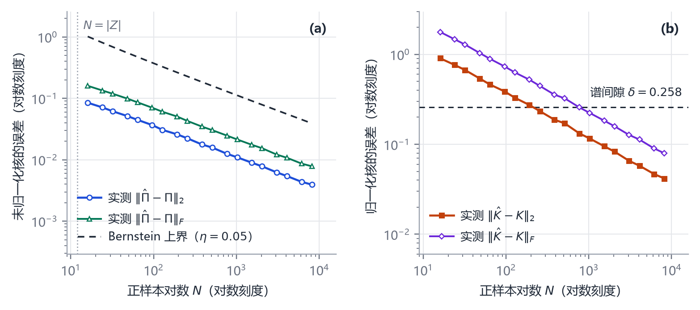
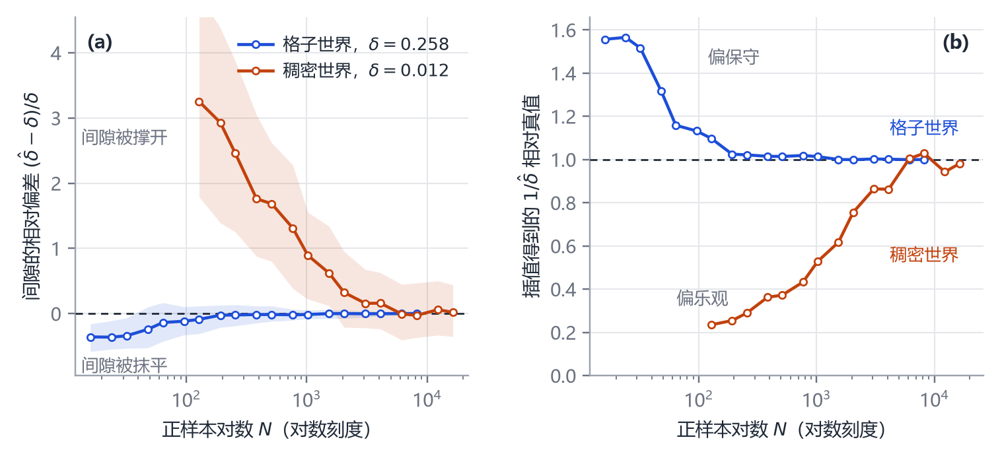
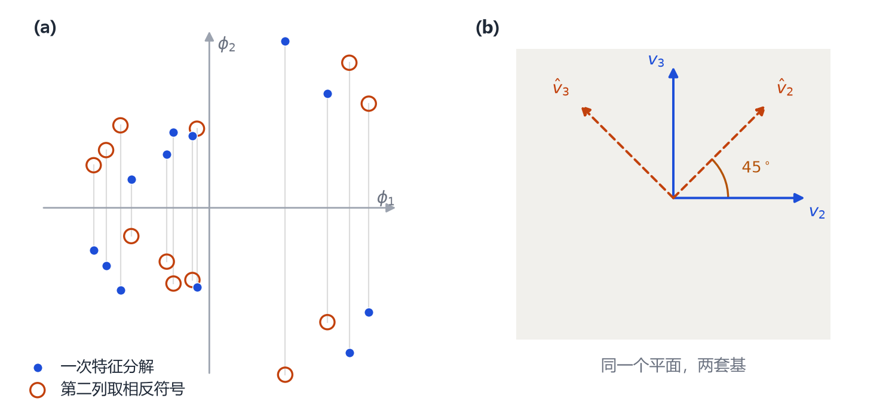
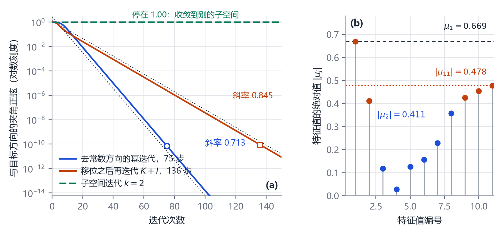

# 第 9 章　谱方法的误差来源

上一章把可辨识性写成了等价类的问题，说明在没有额外约束时，解只能确定到一个变换群，线性、正交、置换各对应一类。那一层不确定是代数的，样本再多也不会让它变小一个比特。结尾留了一句话，命题一与定理一说的都是总体最优，$\pi$ 与 $p$ 精确已知，白化精确成立，谱间隙不为零，四样都不带误差。这一章接着处理那句话里剩下的部分，也就是这四样都要从数据里估出来时，结论会晃多少、往哪个方向晃。

统计层面的不确定最后都落在同一个不等式上。定理二的右边是两个量之比，分子是两个核差多少，分母是谱间隙有多宽，式子里每一个量都是总体的：核是 $\pi$ 自己的核，谱是 $K$ 自己的谱，嵌入是 $\Phi$ 自己，全部由 $|Z|$ 个状态和一张精确的概率表决定。真实流程里这三样一样都拿不到，手里只有 $N$ 对正样本，核要数出来，谱要算出来，嵌入要从算出来的谱里读。两种不确定叠在一起才是完整的误差图景，群的自由度决定哪些差别根本不算差别，抽样误差决定剩下的差别里有多少只是噪声。

拆开看有四层来源。核的集中性管的是数出来的矩阵离真矩阵有多远，谱间隙的估计管的是分母被数错多少，特征向量的方向管的是分子对了之后坐标还能歪多少，数值实现管的是前面三层都对的前提下，算法有没有把答案算成另一个东西。前三层是统计的，最里面那层不是，它属于浮点数和库函数的脾气，出错时不会给出任何警告。

有一处便宜要先说，否则后面容易重复解释。配对抽样同时给出两个边缘，同一对样本的两头都记了账，所以经验核的行和精确等于经验边缘，共享边缘这条前提在估计层面自动成立。第 4 章的合成实验里没有这个便宜，那里的核是先造出来再混合的，混合会破坏边缘，得用 Sinkhorn 迭代缩回去。真实抽样不需要这一步，代价转移到了别处，也就是小概率状态的有效样本量。

## 9.1　有限样本下的经验核

把样本写清楚。取 $N$ 对正样本 $(z_i,z'_i)$，$i=1,\dots,N$，独立同分布地取自 $\pi$，每一对的两个状态在数据里各自对应一次观测。独立同分布这条假设本身也要打个折，视频里相邻两帧配成的正样本高度相关，有效样本量比 $N$ 小，到底剩多少只能靠子采样去量。经验核取成

$$
\hat\Pi=\frac{1}{2N}\sum_{i=1}^{N}\Big(e_{z_i}e_{z'_i}^{\top}+e_{z'_i}e_{z_i}^{\top}\Big),
$$

其中 $e_z$ 是第 $z$ 个坐标为 1 其余为 0 的指示向量。写成两项相加而不是只写一项，是为了让它对称：$\pi$ 本来对称，但样本里哪一头在前是随机的，只用 $e_{z_i}e_{z'_i}^{\top}$ 会让 $\hat\Pi$ 带上一个与抽样顺序有关的偏斜。两项相加之后期望仍是 $\Pi$，对称性精确成立。行和也不难算，$\hat\Pi\mathbf{1}$ 的第 $z$ 个分量是 $z$ 在两个位置上一共出现的次数除以 $2N$，正好是经验边缘 $\hat p(z)$。

于是三个后果一起落地。第一，$\hat\Pi$ 的秩不超过 $N$，它是 $N$ 个秩一矩阵的和，这个上限与 $|Z|$ 无关，第 $N$ 个之后的特征值恒等于零。第二，$\hat K=\hat D^{-1/2}\hat\Pi\hat D^{-1/2}$ 满足 $\hat K\sqrt{\hat p}=\sqrt{\hat p}$，最大特征值精确等于 1，第 2 章那条“归一化让常数方向成为特征向量”的结论在样本上照样成立，误差只在浮点舍入这一层。第三，定理二要求的共享边缘不需要任何额外处理，两个模态各自的样本给出各自的 $\hat p$，只要两份数据来自同一个世界，两个 $\hat p$ 就都在估计同一个 $p$。

集中性可以量。把每一项记作 $A_i=\tfrac12(e_{z_i}e_{z'_i}^{\top}+e_{z'_i}e_{z_i}^{\top})$，它是一个对称矩阵，谱范数不超过 1，期望是 $\Pi$，于是 $\hat\Pi-\Pi=\sum_i Y_i$ 是 $N$ 个独立同分布、期望为零的矩阵之和，每一项的范数被 $1/N$ 压住。矩阵 Bernstein 不等式（matrix Bernstein inequality）说，若 $\|Y_i\|_2\le R$ 且 $\sigma^2=\|\sum_i\mathbb{E}Y_i^2\|_2$，则对任意 $t\ge0$，

$$
\mathbb{P}\Big(\Big\|\sum_i Y_i\Big\|_2\ge t\Big)\le 2|Z|\,\exp\!\Big(-\frac{t^2/2}{\sigma^2+Rt/3}\Big).
$$

代进去，$R=1/N$，$\sigma^2\le 1/N$，得到

$$
\mathbb{P}\big(\|\hat\Pi-\Pi\|_2\ge t\big)\le 2|Z|\,\exp\!\Big(-\frac{Nt^2}{2(1+t/3)}\Big).
$$

读法很直接。要让右端降到 $\eta$，$t$ 得在 $\sqrt{2\ln(2|Z|/\eta)/N}$ 的量级上，反过来就是样本量要 $\ln(|Z|/\eta)/\varepsilon^2$ 的量级。$|Z|=12$、$\eta=0.05$ 时，$N=128$ 给出的上界是 0.327，$N=8192$ 是 0.039，两条都和 $N^{-1/2}$ 一起走，只是多了一个 $\ln|Z|$ 的常数。

这条界在两种情形里立刻踩线。第一种是 $N\lt|Z|$，秩不够，经验核的谱从第 $N$ 个之后被硬生生截成零，世界剩下的部分在坐标里根本不存在，定理二的谱间隙也就无从定义。第二种更早出现，就是有些状态一次都没被抽到。12 个状态的格子上，$N=16$ 时有 55.7% 的试验至少缺一个状态，$N=24$ 降到 12.1%，$N=32$ 才降到 0.7%。缺状态不只是少一行数据，$\hat p(z)=0$ 让 $\hat K$ 的那一行除零，那样的状态没有坐标，也没有权。要让 12 个状态全被看见，$N$ 得在 $(|Z|/2)\ln|Z|$ 的量级，十二个状态对应二十对上下。

两个模态各抽各的样本，两条边缘不会逐点相等。$\hat p_1$ 与 $\hat p_2$ 各自是 $p$ 的一个估计，误差在 $N^{-1/2}$ 量级，把它们放进两个分母，得到的 $\hat K_1$ 与 $\hat K_2$ 就活动在两个略微不同的子空间里。共享边缘这条前提在总体上成立，在样本上只能近似成立，差的那一点与核条目的误差同量级。这一点在解释定理二的数值时要注意，界里没有为两个边缘的差留位置，它假设两边用的是同一个 $p$。想让它精确成立，只有一个办法是把两个模态的样本并成一个池子估一个 $\hat p$，真实流程里做不到，也不该做，因为两个模态的观测本来就不同源。

两个范数的统计速率不一样，这一点在定理二的 $\min$ 里有用。Frobenius 的方差可以逐条目相加，$\mathbb{E}\|\hat\Pi-\Pi\|_F^2=\sum_{z,z'}\mathrm{Var}(\hat\Pi_{zz'})\le 2/N$，因为 $\Pi$ 的总质量是 1，没被抽到的条目本身接近零，不必为它们付代价，指数里的 $\ln|Z|$ 也就不出现。谱范数要为每一个方向各付一次，最坏的那个方向决定了整个界，$\ln|Z|$ 由这里来。两种代价对应两种失配形态：分歧集中在少数状态对上时条目数少，F 那一支紧；分歧摊在几乎所有对上时方向多而均匀，2-范数那一支紧。

归一化会把误差放大。$K_{zz'}=\Pi_{zz'}/\sqrt{p_zp_{z'}}$，每个条目的误差被至多 $1/p_{\min}$ 放大，这个世界的 $p_{\min}=0.0818$，$1/p_{\min}=12.2$。实测的放大倍数是 10.6 到 10.9，与这个数同量级，比它小一点是因为最坏的那个方向通常不落在最小概率的那一行上。含义是有效样本量不是一个 $N$ 对全部状态一视同仁，而是 $Np_{\min}$ 决定最难那个状态的精度。$N=32$ 时归一化的核误差已经到 0.670，超过了间隙 0.258，这一批数据算出来的 $\hat\delta$ 与噪声同量级。

如图 9-1，左图是未归一化核的两个范数误差与 Bernstein 上界，右图是归一化之后的误差与间隙的水平线。$N=32$ 时原始核的谱范数误差是 0.062，Frobenius 是 0.119，两者的比值稳定在 1.9 上下，说明误差矩阵的有效秩不到四，最大的一对状态主导了大部分质量。同一个样本量下归一化的谱范数误差是 0.670，十倍于原始值，图上那条间隙虚线在 $N$ 约两百处被它穿过，两百对之后 $\hat K$ 的误差才落到间隙以下。

上界的松紧程度也在这张图上。实测的谱范数误差只有上界的 0.097，中位数接近十分之一，而且两条线平行，说明松的是常数而不是斜率。要让 Bernstein 上界降到间隙的十分之一，$N$ 得取到 18710；而实测的原始误差降到同一个水平只要 256 对。差出来的这七十多倍来自两处，一处是上界对 $|Z|^2$ 个条目取了并、对最坏方向取了最大，另一处是 $\sigma^2\le1/N$ 这一步把方差按最坏情形估了，真实值要小一个量级。把上界当预算用时，得先在同类数据上标定一个常数，这一点第 4 章已经量过一次，这里量的是它在样本维度上的同一种松。

把这一节的两条结论与 9.4 的扰动界接起来，可以得到一个端到端的速率。核误差在 $\sqrt{\ln|Z|/N}$ 的量级，归一化把它乘上 $1/p_{\min}$，Davis–Kahan 再把它除以 $\delta$，三个因子串起来就是子空间错位的上界。好处是每一项都能单独算，样本量、最小概率、间隙各占一个位置，想改善对齐就知道该动哪一个；坏处是三个因子都是最坏情形，乘起来会松一到两个数量级。真实的标定办法是用这张图，把实测曲线平移一下当预算用，把理论式当检查项，看两者的斜率是否一致，斜率一致就说明没漏掉机制，常数差多少可以实测标定。

<figure class="fig">

<figcaption><b>图 9-1</b>　样本量与核误差。(a) 未归一化经验核的两种范数误差与矩阵 Bernstein 上界，竖虚线在 $N=|Z|$ 处；(b) 归一化之后的误差与谱间隙，$N=32$ 时误差已越过间隙。三组曲线是 140 次抽样的中位数。</figcaption>
</figure>

## 9.2　谱间隙的估计偏差

分母是这一串量里最脆的一个。$\hat\delta=\hat\mu_k-\hat\mu_{k+1}$ 是两个估计值相减，两个误差会叠加而不是抵消。Weyl 的定理给出一句确定的话，$|\hat\mu_i-\mu_i|\le\|\hat K-K\|_2$，于是 $|\hat\delta-\delta|\le2\|\hat K-K\|_2$，间隙的估计误差不超过核误差的两倍。这句话只给宽度，不给方向，界是对称的，而工程上真正要问的是方向，因为 $\hat\delta$ 出现在分母上，偏大偏小差别很大。

方向要从二阶扰动里找。把 $K$ 的特征分解当作未受扰动的基准，扰动 $E=\hat K-K$ 的一阶项只搬动特征向量不搬动特征值，二阶项给出 $\mathbb{E}[\hat\mu_i]\approx\mu_i+\sum_{j\ne i}\sigma^2/(\mu_i-\mu_j)$，$\sigma^2$ 是扰动条目的方差尺度。这个式子的意思是相邻特征值互相排斥：$\mu_k$ 被下面那一堆往上推、被上面那一堆往下推，$\mu_{k+1}$ 受的力方向相同，两者之间因此多出一项 $2\sigma^2/\delta$，间隙被推开；整条谱的其余部分则在往相反方向挤压，把间隙按回一点。两项方向相反，净效果取决于谱的形状，稀疏的尾部排斥赢，密集的尾部挤压赢。

实测的结果比这个推断更极端一些。格子世界（$\delta=0.258$，尾部稀疏）在 $N=32$ 时间隙被抹平 34%，$N=128$ 时 8.9%，$N=512$ 时 1.4%，到两千对才回到 0.06% 以内。另一个 40 状态的稠密世界（谱为 $1$、$0.0503$、$0.0381$、$0.0165$，$\delta=0.0122$）给出的符号完全相反：$N=128$ 时间隙被撑到真值的 4.25 倍，$N=512$ 时 2.69 倍，$N=2048$ 时 1.32 倍，到八千对才落到 3% 以内。所以“样本少时间隙被高估还是低估”没有统一答案，要分两段说：真间隙远大于噪声时，估计把它磨小一点；真间隙小于噪声时，估计把它撑到噪声的水平，而噪声水平与真值差着一个数量级。

第二段的机制值得说透。噪声不会给出一个零间隙，它给出的间隙是两个被随机推动的特征值之差，量级在 $2\sigma$ 上下，与真间隙无关。真间隙小到 0.0122 时，噪声给的间隙是它的三四倍，于是 $\hat\delta$ 看起来健康，实际上只是在报噪声。这也解释了为什么不能靠“样本少就保守”这句经验来做判断，样本少恰恰是乐观的一端，界被撑大之后 $\hat\delta$ 变大、$1/\hat\delta$ 变小，算出来的上界小得让人放心。

如图 9-2，左图是两种世界间隙的相对偏差随样本量的变化，两条曲线的符号相反，各自收敛到零；右图是插值得到的 $1/\hat\delta$ 与真值的比。稠密世界在 $N=128$ 时这个比值只有 0.235，也就是上界被低估了近四倍，五百对时是 0.372，两千对时 0.755，要到八千对才回到 1 附近。格子世界在同一批样本量下的比值是 1.516 与 1.098，方向相反，上界被高估，属于保守的一端。

间隙还依赖一个超参，就是 $k$。$\hat\delta$ 是给定 $k$ 之后第 $k$ 与第 $k+1$ 个特征值之差，换一个 $k$ 就换一个分母，界也跟着变。工程上常见的做法是取最大的 $k$，使 $\hat\mu_k-\hat\mu_{k+1}$ 仍大于噪声水平，这等于用数据自己挑一个 $\hat\delta$，挑出来的那个数天然落在“刚好大于噪声”的位置，比事先定下 $k$ 更乐观。这与多重比较是同一类问题，在若干个候选位置里挑一个最有利的比值，挑中者的期望被抬高了。稳妥的做法是把 $k$ 写进预注册，或者对 $k$ 的搜索一并做校正。

噪声水平怎么估，是一个实践问题，三条路都可行。一条是子采样，把 $N$ 对样本随机分成两份，各自算一个 $\hat K$，两份之差的范数给出 $2\|\hat E\|_2$ 的一个估计，重复多次取中位数。另一条是 bootstrap，按对重抽，看 $\hat\delta$ 的分布宽度，宽度的一半近似 $2\|\hat E\|_2$。最省事的一条是用 Weyl 反过来推，把 9.1 那条理论界代进去，得到的是偏大的噪声水平，用在“界到底有没有内容”这个判断上够用。三条路给的数不一样，但判据只需要知道 $\hat\delta$ 与 $\|\hat E\|_2$ 的比值落在哪个区间，不需要精确值。

除了偏差，还有一层结构性的问题，与样本量无关。函数 $1/x$ 在正半轴严格凸，所以 $\mathbb{E}[1/\hat\delta]\gt1/\mathbb{E}[\hat\delta]$，只要 $\hat\delta$ 有波动，插值得到的倒数在平均意义上就比“倒数再取期望”大。这句话单独看是对称的，加上前面的偏差才不对称：偏差把 $\hat\delta$ 推大，凸性把 $\mathbb{E}[1/\hat\delta]$ 往上抬，两者一个缩小一个放大，净方向由偏差主导，因为偏差可以是几倍，凸性的修正只有百分之几。

最坏的情形是 $\hat\delta$ 落到非正。真间隙小于噪声时，两个被推动的特征值可以交换位置，$\hat\delta$ 变成零或负数，$1/\hat\delta$ 无定义，插值上界直接失效。即使没到这一步，Weyl 给出的区间 $[\hat\delta-2\|\hat E\|_2,\ \hat\delta+2\|\hat E\|_2]$ 也给出了正确的报告方式，下端一旦小于等于零，就该写“这一批数据不支持这条界”，而不是硬报一个数。本节的两个世界里 $\hat\delta$ 始终为正，原因是它们的间隙要么远大于噪声、要么正好落在噪声能撑开的范围里，换一个真间隙恰好为零的世界，$\hat\delta$ 落成负数并不罕见，因为两个被推动的特征值交换位置不需要任何代价。

<figure class="fig">

<figcaption><b>图 9-2</b>　间隙估计的偏差。(a) 相对偏差 $(\hat\delta-\delta)/\delta$ 随样本量变化，两种世界的符号相反，带子是四分位区间；(b) 插值得到的 $1/\hat\delta$ 相对真值，稠密世界在少样本时被低估近四倍。</figcaption>
</figure>

## 9.3　符号、旋转与简并块

特征向量只有方向，没有朝向。$v$ 与 $-v$ 满足同一个方程，都是合法的答案，库函数返回哪一个是约定而不是结论。LAPACK 有一套符号规范化的规则，但不同版本、不同 BLAS 分支、不同的并行归约顺序都可能给出不同的符号，同一份矩阵在两台机器上跑，得到的 $\Phi$ 可以整体差一次镜像。后果要分三层看，坐标值整体变号是最表面的一层，两两距离、夹角、Gram 矩阵全不变是中间一层，最里面那层是“第几个坐标对应哪个属性”这句话失去了意义。

距离不变可以从代数上确认。第二列取反相当于右乘一个对角矩阵，对角元是 $1$ 与 $-1$，它正交，所以 $\|\Phi(z)-\Phi(z')\|$ 逐点不变。本书在一个 12 状态的随机几何世界上量过这件事，翻转之后两两距离的最大改变是零，一位有效数字都没有动。要用两个独立的嵌入做比较，先得把符号对齐，对齐之后的距离是 $\min_{s=\pm1}\|\hat v-sv\|=\sqrt{2-2|\langle\hat v,v\rangle|}$；不做这一步，两个向量的距离最大可以到 2，相当于完全没有对上。余弦相似度取绝对值能消掉符号，可视化不能，这也是看图比看数更容易被骗的地方。

单个特征向量的稳定性由两侧较近的那个间隙决定。Davis–Kahan 的结论是 $\sin\theta\le\|E\|_2/\mathrm{gap}$，对单个向量来说 $\mathrm{gap}$ 要取 $\min(\mu_{i-1}-\mu_i,\ \mu_i-\mu_{i+1})$，两侧都得留出空档它才稳。12 状态的格子上，$v_1$ 两侧是 $1-0.6694=0.3306$ 与 $0.6694-0.4114=0.2580$，取小的那个 0.2580；子空间取 $k=2$ 时只用外侧那一个，$\mu_2-\mu_3=0.2938$，比 0.2580 大 14%。差别不大，但方向是对的，子空间比它里面的单个向量更抗扰动。

这个差别在简并附近会放大成性质上的不同。构造一个 $5\times5$ 的对称矩阵，特征值是 $1$、$0.6$、$0.6$、$0.2$、$0.05$，第二个与第三个重合。在块内加一个 $0.012$ 的耦合，也就是沿这两个特征向量各取一个方向做外积再相加，新特征值变成 $0.612$ 与 $0.588$，两个特征向量各自转了 45.0 度，而它们张成的子空间距离是 $1.41\times10^{-15}$，精确不动。再把耦合伸到块外，接上 $0.2$ 那个方向，幅度取 $0.004$，子空间距离变成 $1.42\times10^{-2}$，与 $2\varepsilon/(0.6-0.2)=0.02$ 同量级。所以“单个向量可以任意转”与“子空间纹丝不动”不是程度差别，是两件不同的事。

这也解释了定理一为什么对 $K_{\pi_1}$ 那么宽容，允许它在 $k$ 处有重特征值。定理一比较的是子空间，重特征值只在子空间内部换了一组基，换基不改变子空间，也就不改变结论。反过来说，任何需要“第 $j$ 个坐标就是第 $j$ 个属性”的下游处理，都必须先确认间隙大于噪声，否则它读到的是库函数的约定。工程上的做法是把比较对象换成投影算子、距离矩阵或者 CKA 这类对正交变换不变的量，实在要比单个向量，就先定符号再报对齐之后的距离。

两个编码器接起来的时候，符号与旋转要一起处理。Procrustes 给出的最优 $Q$ 里已经含了符号，因为 $O(k)$ 包括反射，先对齐再读轴是正确顺序，反过来先猜符号再对齐，会把手算错的那部分算进残差。对齐之后还要问一句轴的解释力有多少，判据仍然是间隙，$\hat\mu_j-\hat\mu_{j+1}$ 小于 $2\|\hat E\|_2$ 时第 $j$ 个轴与第 $j+1$ 个轴可以互换，任何“这一维是颜色、那一维是形状”的说法都是过度解读。稳妥的写法是报子空间，比如“前两维张成的平面里编码了位置”，而不去给单个轴命名。

如图 9-3，左边是同一个嵌入在两套符号约定下的样子，蓝点与空心圈关于横轴镜像，灰色细线把对应的点连起来，每一对都在同一列上；右边把简并块画成一个平面，两套基各自转了 45 度，平面本身没动。这张图想说的是，符号与简并这两件事都不改变几何，改变的是坐标轴的编号，而编号是人给的，不是数据给的。

<figure class="fig">

<figcaption><b>图 9-3</b>　符号与简并块。(a) 第二列取反后点云上下镜像，两两距离逐点不变；(b) 二重特征值的块内扰动让两个基向量各转 45 度，张成的平面不动。左图是一个 12 状态随机几何世界的前两个坐标。</figcaption>
</figure>

## 9.4　数值实现与迭代

最省事的做法是一次稠密特征分解，$|Z|$ 在几十到几百的量级时它比任何迭代都快，代价是 $|Z|^3$。$|Z|$ 上千之后就要换成迭代，而迭代的第一步有个坑，踩上去不会报错。幂迭代的式子写作 $u_{t+1}=Ku_t/\|Ku_t\|$，它在哪个特征向量上停下来由模最大的特征值决定。$K$ 的模最大的特征值恰好是 1，对应的特征向量是 $\sqrt p$，也就是被谱嵌入扔掉的那一维。本书在 12 状态的格子上跑了六十步，迭代向量与 $v_1$ 的夹角正弦停在 1.0000，一次都没有下来，原因是 $\sqrt p$ 与 $v_1$ 在数值上精确正交，内积是 $9.16\times10^{-16}$。

去掉常数方向的办法是在迭代之前把 $\sqrt p\sqrt p^{\top}$ 减掉，或者每一步都把迭代向量投影到它的正交补上。这一步做完，收敛速率就不再是 $\mu_2/\mu_1$。教科书上的估算给出 $0.4114/0.6694=0.6145$，四十七步到 $10^{-10}$，而实测的斜率是 0.7127，七十五步才到。差别的来路在核的谱有一半是负的，第 2 章已经说明 $\mu$ 落在 $[-1,1]$，二分图上还能取到 $-1$，而幂迭代按绝对值衰减，不看符号。这个世界的第 11 个特征值是 $-0.4776$，绝对值 0.4776 大于 $\mu_2=0.4114$，所以慢的那一端是负端，真正的速率是 $0.4776/0.6694=0.7135$，与实测的 0.7127 对得上。

步数的三个估计可以摆在一起看。按 $\mu_2/\mu_1$ 算是 47.3 步，按负端算是 68.2 步，实测 75 步，前几步的差距来自初值的方向还没有被压到慢衰减的那条线上。这个差别在工程上意味着两件事，一是按代数第二特征值估算迭代预算会低估成本，二是“谱间隙大就收敛快”这句话只对谱的两端同号时成立，核的谱从来不是这样。

子空间迭代的失败更彻底。取 $k=2$，每一步把 $12\times2$ 的基做一次 $K$ 的作用再正交化，六十步之后与 $\mathrm{span}(v_1,v_2)$ 的最大主夹角正弦停在 1.0000，也就是两个子空间正交。原因与上一段相同，只是更严重，因为 $k=2$ 的吸引子是模最大的两个方向，即 $v_1$ 与 $v_{11}$，前者是想要的，后者是最负的。这是一个很难发现的结果，曲线收敛得很漂亮，夹角一路下降，只是降到的是另一个地方。

修法有两条。一条是移位，把 $K$ 换成 $K+I$，谱整体抬进 $[0,2]$，负端被抬到 $0.5224$，所有特征值非负，模最大与代数最大重新重合。代价是速率变慢，$1.4114/1.6694=0.8454$，实测斜率正好是 0.8454，136 步到 $10^{-10}$，与估算的 137.1 步吻合。另一条是移位求逆，对 $(K+\sigma I)^{-1}$ 做迭代，把想要的那一端放大，代价是每一步要解一个线性方程组，稠密时那是一次分解，成本与一次特征分解相当，只在有快速解法时划算。

库函数的选择原则就是这个道理。ARPACK 里的反幂法与隐式位移都用同一个参数指定要哪一端，which 取 “LA” 是代数意义的最大，正好避开负端，取 “LM” 是模最大，会落回幂迭代的坑。稀疏接口还有两个细节，一是要常数方向被扔掉，就得请求 $k+1$ 个再丢第一个；二是收敛容差是相对量，默认值贴近机器精度，迭代次数会因此变多，实践中放宽到 $10^{-8}$ 通常够用。返回的顺序不要依赖，拿到之后自己按特征值排一遍，下面这三行就是全部流程。

```python
w, V = np.linalg.eigh((K + K.T) / 2)        # 先对称化，消掉缩放留下的不对称
w, V = w[::-1], V[:, ::-1]                  # 自己排序，不依赖库的返回顺序
Phi = V[:, 1:k + 1] / np.sqrt(p)[:, None]   # 丢掉常数方向，再除以 sqrt(p)
```

浮点精度也在这条线上。第 2 章算过，12 状态的格子上 $\lambda_0$ 是 $4.4\times10^{-16}$，是舍入留下的余量而不是零。双精度下这个余量比任何有意义的间隙小十几个数量级，不影响判断；单精度下它变成 $10^{-7}$，与本节那种 $0.012$ 的真间隙只差五个数量级，再小一点就分不开了。判据可以写成一句话，$\hat\delta$ 要比机器精度乘上 $\|K\|_2$ 大两三个数量级，达不到就换双精度或者换一个分解算法，不要在那个数上做判断。

简并的处理要放在排序之后。判据是 $\hat\mu_k-\hat\mu_{k+1}$ 与 $2\|\hat E\|_2$ 比大小，小于这个量级时“第 $k$ 个坐标”不可解释，因为块内任意一组正交基都是合法答案。这时候要么把结论写到子空间这一层，要么加一条人工约定把基固定下来，比如让每个向量绝对值最大的分量为正，再在块内按第三个算子（一个与 $K$ 对易的小扰动）分解一次。约定能让人看到同一张图，但它只是约定，换一个人换一份数据就会变。

规模决定用哪条路。稠密分解是 $\tfrac43|Z|^3$，幂迭代每一步是 $2|Z|^2$，交叉点在 $|Z|$ 约等于迭代次数的 1.5 倍，用本节这个核的 75 步来算，$|Z|$ 在一百一十上下。$|Z|=12$ 时一次分解抵得上九次完整迭代，稠密分解完胜；$|Z|=1000$ 时反过来，迭代省下近十倍。真实流程里 $|Z|$ 这个概念本身就要换掉，核定义在 $N$ 个样本上，是一个 $N\times N$ 的矩阵，$N$ 上万时连矩阵都存不下，只能用核矩阵与向量的乘法配 Nyström 或随机特征。那时前 $|Z|$ 个特征向量才对应状态级的坐标，第 $|Z|$ 个之后的是样本级的噪声方向，两者混在一条谱上，靠间隙分开。

停机判据也值得说一句。常见的实现监控残差 $\|Ku-\hat\lambda u\|$，它下降得快，但它只说明 $u$ 接近某个特征向量，不说明那个特征向量是想要的那一个。前面子空间迭代的例子就是这样，残差一路降到机器精度，夹角始终在 90 度附近。可靠的判据有两个，一是 $\hat\lambda$ 在连续几步里的变化小于容差，二是用两个不同初值各跑一遍，看两个结果的相关系数，接近 1 才算真的收敛到同一个方向。

$N$ 上万时，除了存不下，还有一个隐性的成本，每一次核矩阵与向量的乘法都要遍历 $N^2$ 个条目，迭代几十步就是几十次 $N^2$，与直接分解同一量级。真正省时间的做法是换表示，把核写成特征内积 $k(x,x')=\langle\phi(x),\phi(x')\rangle$，用随机特征或 Nyström 把 $N\times N$ 压成 $N\times m$，$m$ 取几千，代价是引入一个近似误差。它和抽样误差不是一回事，也不会随 $N$ 减小，两笔要分开报，混在一起会让人误以为加样本能修掉近似带来的偏差。

如图 9-4，左图是三条迭代曲线的误差随步数下降，蓝线是去常数方向的幂迭代，橙线是再移位之后的幂迭代，绿线是 $k=2$ 的子空间迭代，它停在 1.00 不动。右图把特征值的绝对值按编号画出来，$\mu_1=0.669$ 与 $|\mu_{11}|=0.478$ 两条水平线一摆，就能看出为什么慢的一端是负端，以及为什么移位之后速率会掉到 0.845。

<figure class="fig">

<figcaption><b>图 9-4</b>　三种迭代在同一个核上的收敛。(a) 误差是夹角正弦，虚线是各自的渐近斜率，空心点标出曲线落到 $10^{-10}$ 的位置，步数写在图例里；(b) 特征值的绝对值，负端的 $|\mu_{11}|=0.478$ 大于 $\mu_2=0.411$，决定了幂迭代的瓶颈。</figcaption>
</figure>

## 9.5　上界里哪些量被样本污染

回到定理二。不等式左边是最优旋转之后的均方根距离，右边是 $2\sqrt2/\delta$ 乘核失配。三处都有样本的影子，左边的两个嵌入是估出来的，分子是两个估出来的核之差，分母是一个估出来的间隙。三处污染的方向不一样，量级也不一样，把它们分开看，才知道这个界在什么情况下能当保证用。

分子偏大，理由是范数的凸性。记两个核的抽样误差为 $\hat E_1$ 与 $\hat E_2$，估计出来的失配是 $\|(K_1-K_2)+(\hat E_1-\hat E_2)\|$，它的期望不小于 $\|K_1-K_2\|$，因为范数满足 $\|\mathbb{E}X\|\le\mathbb{E}\|X\|$。也就是说，用两批独立样本估出来的核失配，平均而言比真失配大，方向是保守的。这一条有个前提，两份误差要独立；如果两个模态的核来自同一批图像、同一批文本，误差相关，抵消的方向就不定了，可能偏大也可能偏小。工程上很少有两批完全独立的样本，所以这条保守性只能算半个。

分母偏小，理由在 9.2 已经说过，是偏差加凸性。稠密世界在 $N=128$ 时插值得到的 $1/\hat\delta$ 只有真值的 0.235，$N=2048$ 时 0.755，这个方向的偏差比分子的保守性大三到四倍。两个方向叠在一起，净效果并不自动抵消，因为一个是乘在分子上的百分之几十，一个是乘在分母上的几倍。真实情形里分母那一侧更值得防，它错的时候给出的是一个更小、更漂亮的界。

左边也偏大。样本级的 Procrustes 误差把真错位与两边的抽样噪声混在一起，噪声那一份只会让距离变大，所以量出来的误差是真实错位的一个上界。这一条常被读反，看到实测误差远小于上界就以为定理得到了验证，实际上那个误差里有一部分是噪声，真错位比它小，界比看起来更松。

还有一个容易忽略的耦合。$\hat\delta$ 与 $\|\hat K_1-\hat K_2\|$ 用的是同一批样本，两个估计不独立。样本里某几个状态对出现得特别多时，核的那几个条目被估得更准，间隙也被那几条边主导，分子的偏大与分母的偏小会同时出现，界往乐观的方向跑得比各自的偏差更快；反之样本稀疏的那一侧会把分子推大而几乎不动分母，界变保守。要判断落在哪一种，只能把样本按状态分层，看误差集中在哪一层，这一步比多跑几个种子有用。

判据可以写得很干脆。$\delta$ 远大于 $\|\hat E\|_2$ 时，界的内容由核失配决定，样本污染只在第二位；两者同量级时，界的内容由噪声决定，定理二说的那句话在数据上不成立任何东西。12 状态的格子上，$N=32$ 时归一化核误差 0.670 是间隙 0.258 的 2.6 倍，代进去右端大于 1，两个白化嵌入的均方根距离本来是 0.1 量级，界比它大一个数量级还多，这种界没有信息量。要让右端落到间隙的十分之一以下，$N$ 得在两万对的量级，与 9.1 那条实测曲线对得上。

三个可操作的做法跟着出来。报界的时候报区间，把 $\hat\delta$ 换成 $[\hat\delta-2\|\hat E\|_2,\ \hat\delta+2\|\hat E\|_2]$，下端非正就写不支持。报误差的时候报两个数，原始核的与归一化之后的，并附上 $p_{\min}$ 与 $Np_{\min}$，因为放大倍数全在这两个数里。报间隙的时候把核误差一起报，一个孤零零的 $\hat\delta$ 读者无法判断它是结构还是噪声。

还有一处便宜值得记下来。定理二的前提里，共享边缘这一条在估计层面不需要额外工作，同一次配对抽样同时给出两个边缘，$\hat\Pi\mathbf1=\hat p$ 精确成立。所以被样本污染的量只有两个，核差多少与间隙多宽，边缘那一条是白送的。第 4 章的合成实验没有这个运气，那里的核是造出来的，混合之后边缘会偏，得用 Sinkhorn 迭代缩回去，缩到 $10^{-13}$ 以下才敢算间隙。真实数据和合成实验的这一处差别，正好说明同一条前提在两种场景下的成本完全不同。

把这一章的四层放在一起看，可以得到一句还算实用的判断。定理二不是一条能直接代数的公式，它是一张清单，列出哪几个量决定了错位，以及每个量的估计误差会往哪个方向推。清单上的量都能估，每个估计都带自己的误差，误差的方向各自不同，能做的只是把每一个都报清楚，再把最脆的那一个（也就是间隙）单独交代。缝隙里剩下的那点不确定，靠样本量压，靠不了别的东西。

从第 2 章到这一章，谱方法这条线走完了一个闭环。图给出核，核给出谱，谱给出坐标，坐标之间的差别由间隙与核失配决定，而这两样在有限样本下各有自己的误差。整条链上没有一处需要“表征趋同”这个说法，趋同是算出来的结果，不是假设进来的前提。这里没有一条定理是错的，错的只可能是引用它的人对量的理解，而理解的第一步就是把总量写成估计量。

下一章把这张清单变成实验。哪些量能改、改了会动到界里的哪一项、跑几个种子才算报了一个数、预注册怎么写，这些问题的答案都在定理的变量表里，只是需要有人把它翻译成实验设计。翻译的时候要一直记得这一章的结论，量都能估，但没有一个估得准到可以当常数用。
