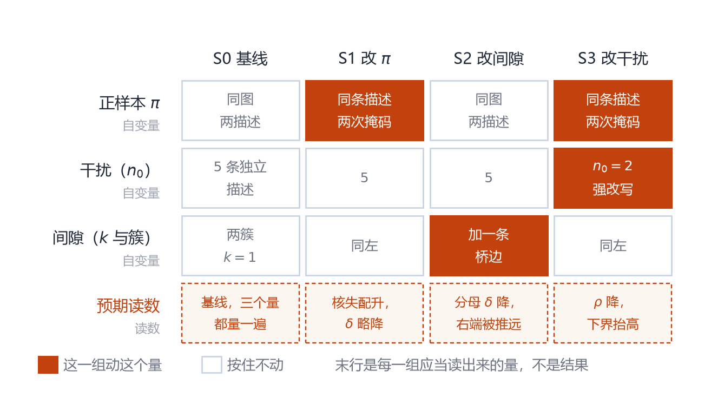
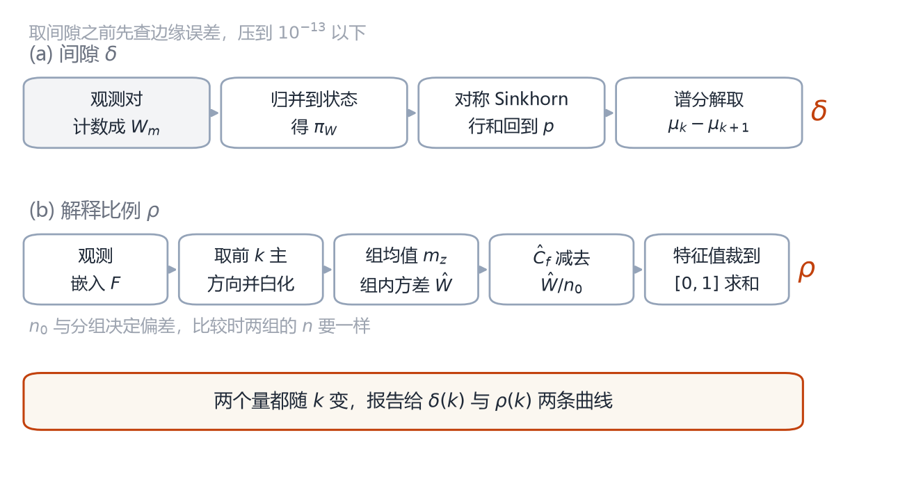
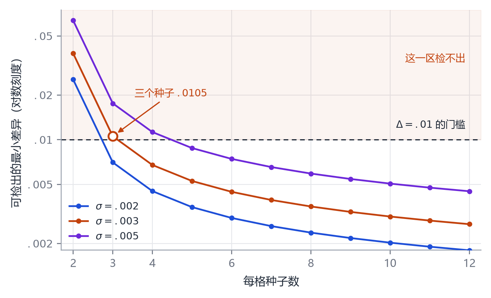
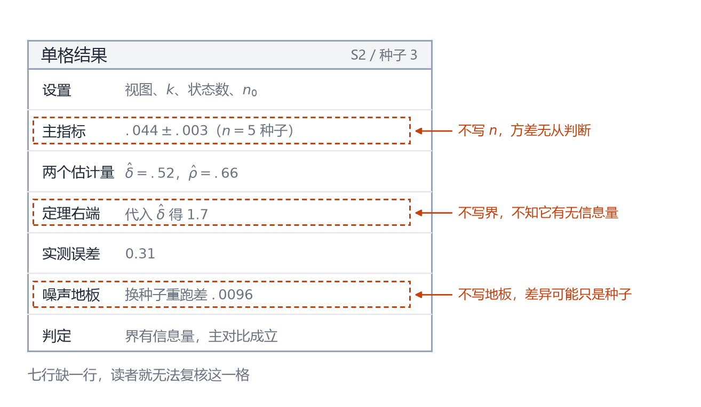

# 第 10 章　从定理到实验

定理写在纸上时是干净的，等号、范数、正交群，每一处都指得出来。等到实验台上，同一件事变成一堆需要选的参数，视图怎么切，状态怎么分，跑几个种子，报哪一个数。两者之间的距离不是靠更仔细的推导填平的，而是靠一份设计，这份设计要把式子里的每个符号落到一个具体的操作上。这一章讲的就是这份设计怎么从定理里长出来，而不是从惯例里抄过来。

前面四章一共交出了三个不等式，它们的形式不同，结构却一样，左边是一个可以实测的误差，右边是几个可以事先估出来的量。定理二的右端是核失配除以谱间隙，定理三的下界是一减场景解释比例再乘两倍维度，定理四把谱解离自己核的距离写成混合程度除以间隙。上一章把这些量被样本污染的方式逐个拆开，说明了每一个估计值都带偏差与方差，也说明了哪些偏差能靠加大样本消掉，哪些消不掉。这些量因此不是定理里那些理想对象，而是带误差的估计值，后面每一步规划都要按估计值来做，不能按符号来想。

三个不等式加起来给了五个符号，$k$、$\delta$、$\lVert E\rVert$、$\rho$、$\varepsilon$。实验的第一步不是跑一次训练，而是决定哪个符号由哪一行代码产生，哪个符号只能被读出来，哪个符号可以被人为拨动。这三类分清楚之后，剩下的工作才有顺序，否则跑完一轮也说不清哪个数字该对哪个符号负责。按估计值来规划还有一层好处，它把每步的成败变成可以检查的读数，而不是一个关于整体好坏的感觉。

有一条判断值得先放在最前面。这五个符号里只有 $k$ 与正样本的定义能被人随便改，其余三个都是世界的性质，改它们等于改世界。把它们当成旋钮来拧，实验会变成自己跟自己打架，因为你拧动一个，另外两个跟着变，谁也说不清差异来自哪里。这一条是后面所有设计的地基，也是真实实验与合成实验分道扬镳的地方。

## 10.1　从定理反推实验

三个不等式的右端可以摊在一张纸上，共用哪几个符号看得很清楚。定理二的形式最完整，五个符号里有三个出现在它身上，所以先看它。

$$
\min_{Q\in O(k)}\Big(\mathbb{E}_p\big\lVert\Phi_1(z)-Q\Phi_2(z)\big\rVert^2\Big)^{1/2}
\le \frac{2\sqrt2}{\delta}\min\Big(\sqrt{k}\,\lVert K_{\pi_1}-K_{\pi_2}\rVert_2,\ \lVert K_{\pi_1}-K_{\pi_2}\rVert_F\Big),
$$

式子里 $E=K_{\pi_1}-K_{\pi_2}$ 是两个核的差，$\delta$ 是第二个核的谱间隙，$k$ 是嵌入维度。定理三的下界是 $2k(1-\rho)$，只添了一个新符号 $\rho$，它量的是嵌入里能被状态解释的那部分占多大份额。定理四的 $\tau_m$ 把右边的结构又用了一次，多出来的是交叉块的大小 $\varepsilon_m$ 与干扰自身的保留度 $\eta_m$。三个式子摆在一起，符号的分工就清楚了，$k$ 决定在几维上对齐，$\delta$ 与 $\rho$ 描述世界，$\lVert E\rVert$ 与 $\varepsilon$ 描述失配。

五个符号里，两个可以拧，三个只能量。可以拧的是 $k$ 与正样本的定义，前者是一行配置，后者是数据管道里的一句判断。只能量的是 $\delta$、$\rho$ 与两个失配，它们由世界与数据决定，实验者改不动，只能把它们测出来。这个二分看起来简单，它决定了整章的叙述顺序，先讲怎么拧，再讲怎么量，然后讲量出来怎么报。

拧 $k$ 的代价最小，也最容易被误用。$k$ 同时出现在分子与分母上，分子那一支随 $\sqrt k$ 长，分母那个 $\delta$ 随 $k$ 掉，两个方向都让界变松。这不是说 $k$ 该取小，而是说 $k$ 必须事先定，定完之后 $\delta(k)$ 是一条曲线而不是一个数。本书脚本在一个两簇、每簇十二个状态的合成世界上量过这件事，$\delta(1)$ 是 .95，$\delta(2)$ 掉到 .002，同一批数据、同一个核，只因为多要了一维，间隙就没有了。这条曲线说明 $k$ 的选择不是精度与成本的折中，而是定理还能不能用的问题。

拧正样本的定义是唯一真正自由的旋钮。同一张图的五条人工描述，取任意两条配上，与取同一条描述挖掉两个词之后的两份残句配上，是两个完全不同的 $\pi$，前者连的是场景，后者连的是写法。这个改动只发生在数据管道的一行判断上，不改模型也不改损失，代价却直接落在 $E$ 上。第 6 章把它写成了诱导世界核，观测层的正样本对按状态归并，就得到状态层的一张图。核一变，定理二右端的分子与定理四右端的 $\varepsilon_m$ 一起变，两个符号同向移动。

干扰那一侧可以拧，拧法受数据限制。$\rho$ 由每个状态的观测数与观测之间的差异幅度决定，Flickr 的一张图有五条独立描述，这就是五次干扰抽样。把观测数压到二、或者把改写幅度调大，$\rho$ 会掉下去，但这两件事同时也改变了核的形状，因为观测少了，同一个状态内部的样本连不成片。$\rho$ 的旋钮与 $\pi$ 的旋钮在物理上共用一根轴，这是真实数据与合成世界最大的差别。真实实验里只能承认这条联动并把它测出来，合成世界里才能把它们分开。

<figure class="fig">

<figcaption><b>图 10-1</b>　实验设计矩阵。三行是三个自变量，四列是四组设置，实心格表示这一组动它；末行是每一组应当被读出来的量，不是结果。</figcaption>
</figure>

如图 10-1，四列的设计各有对准的符号。S0 是基线，好视图、每个状态五个观测、两簇且簇间有间隙。S1 只换正样本，把同图两描述换成同条描述的两次掩码。S2 只动间隙，在世界的一条边上加质量，让两个簇之间多出一条桥。S3 在 S1 的 $\pi$ 上把观测数压到二并加强改写，动的是 $\rho$。四组之间不是随便排的，S1 与 S3 共享同一个 $\pi$，S2 与 S0 共享同一个 $\rho$，每一列的读数都有参照。

末行那四格是用法说明，不是装饰。S1 的预期是核失配升、$\delta$ 略降，因为掩码视图把写法连起来，核的形状跟着变。S2 的预期是分母掉、右端被推远，实测误差不必动，界自己就松了。S3 的预期是 $\rho$ 掉、下界抬到 $2k(1-\rho)$。三组各自检验一个符号，读数的方向事先写在格子里，跑完只要看方向对不对，不必等完整的统计检验。方向错了，说明对符号的定位本身就错了，这时补种子没有用，要回去重看设计。

这样一套设计只能看出三个主效应，看不出交互。它仍然有用，因为每一次改动都对准了一个符号，读数与符号之间有明确的对应，出了偏差能追到具体一步。真正的全因子要八组，见 10.4 节。四周时间跑不完八组乘三个种子，所以先跑这四组把方向定下来，再决定要不要补格子。四组跑完若三个方向都对上了，全因子的钱就不必花，这一步省下来的是后面的全部时间。

还有一条顺序上的要求，先在合成世界上把三个符号算清楚，再在真实编码器上跑。合成世界的核是写出来的，$E$ 与 $\delta$ 都能精确算，不等式被检验的是算术。真实实验里核是数出来的，两个量都带误差，一个界不成立时你分不清是定理错了、估计错了，还是实验根本没有落进定理的假设。第 4 章那 80 个世界做的正是第一件事，它检验的是推导，不是训练。两组实验各自回答一个问题，混着做，两个问题都回答不了。

定理四比前两条多一个符号，原因在它把间隙改写过。它的间隙是 $\delta_m=\mu_k-\max(\mu_{k+1},\eta_m)$，第 $k$ 个状态方向不但要压过下一个状态方向，还要压过最强的那个被保留下来的干扰方向。这意味着估计间隙时不能只取谱的间隔，还要把干扰块的最大特征值 $\eta_m$ 一并算出来，取两者之差。$\eta_m$ 的量法是把核在干扰那块子空间上取出来求最大特征值，它衡量一对正样本在多大程度上保留了自己那份干扰。多这一步的收益，是把视图坏到什么程度这句话拆成两个可以分别量的数。

## 10.2　怎么估 δ 与 ρ

两个量都在跑主实验之前就能拿到，因为它们不需要训练，也不需要任何一对配对样本。$\delta$ 需要正样本对，$\rho$ 需要一个模态里同一状态的多个观测，两者都是数据管道里现成的东西。这一点决定了它们的地位，它们是这套实验里唯一可以先算后跑的量，也是唯一能在开跑之前就否掉一套设计的量。一套设计若在第一步就查出间隙为零，后面的训练一次都不必跑。

$\delta$ 的估法分四步，如图 10-3 上面那条通路。把正样本对在观测层数成一张矩阵 $W_m$，行与列都是观测，格子里是这一对被连起来的次数。把同一状态的全部观测合并成一个节点，$W_m$ 在合并图上求和，得到状态层的诱导核 $\pi_W$，它的行和自然等于 $p$。做对称 Sinkhorn 缩放，让行和精确回到 $p$，不缩放的话最大特征值不等于一，间隙无从谈起。对 $K=D^{-1/2}\pi_WD^{-1/2}$ 做特征分解，去掉恒等于一的那一个，取第 $k$ 与第 $k+1$ 个特征值之差。

<figure class="fig">

<figcaption><b>图 10-3</b>　两条估计流水线。(a) 从正样本对到谱间隙，(b) 从单模态嵌入到场景解释比例；两条都不训练，两个量都随 $k$ 变，所以要报曲线。</figcaption>
</figure>

四步里有三个坑，每个都能把 $\hat\delta$ 拉到另一个数量级。合并的粒度决定 $\pi_W$ 的一切，状态划得太细，每组观测太少，核接近对角阵，间隙被高估；划得太粗，两个真状态被并成一个，间隙被抹平。Sinkhorn 的停机容差要报到 $10^{-13}$ 以下，第 4 章量过，容差停在 $10^{-2}$ 时最大特征值落在 .99 附近，而聚簇世界的间隙本身只有 $10^{-2}$ 到 $10^{-3}$，分母可能错一倍。$k$ 不能事后挑，理由 10.1 已经给过，$\delta$ 是 $k$ 的函数，换一个 $k$ 就换了一个分母，也就换了一个待检验的命题。

$\rho$ 的估法也分四步，与第 5 章 5.4 节一致。把嵌入投到前 $k$ 个主方向并白化，使总协方差恰好是 $I_k$。对每个状态把它的 $n_0$ 个观测求平均，得到条件均值的一个样本，五次平均把五次干扰压掉一部分。把 $C_f$ 估成组均值的协方差减去 $n_0$ 分之一的组内协方差均值，减这一项是因为平均只保留了 $1/n_0$ 的组内方差。把特征值裁到 $[0,1]$，取平方根求和再除以 $k$。白化必须在求平均之前做，否则组内方差已经被平均抹掉，$\hat\rho$ 里要减的那一项无从算起。

代码骨架如下，两个函数各自对应上面的四步，输入是数好的正样本矩阵与抽好的嵌入。它不处理 $k$ 的选择，也不给置信区间，那两件事分别归 10.1 与 10.3 节。

```python
import numpy as np

def spectral_gap(Pi, p, k):
    a = np.ones_like(p)
    for _ in range(500):                          # 对称 Sinkhorn，行和回到 p
        a = a * np.sqrt(p / (Pi * np.outer(a, a)).sum(1))
    K = Pi * np.outer(a, a) / np.sqrt(np.outer(p, p))
    mu = np.linalg.eigvalsh(K)[::-1][1:]          # 去掉恒为 1 的那个
    return mu[k - 1] - (mu[k] if k < len(mu) else -np.inf)

def scene_fraction(F, gid, k):
    F = F[:, :k] - F[:, :k].mean(0)
    L = np.linalg.cholesky(np.cov(F.T) + 1e-8 * np.eye(k))
    Z = np.linalg.solve(L, F.T).T                 # 白化，Cov(Z) = I_k
    ids = np.unique(gid)
    M = np.stack([Z[gid == g].mean(0) for g in ids])
    W = np.mean([np.cov(Z[gid == g].T, bias=True) for g in ids], 0)
    lam = np.clip(np.linalg.eigvalsh(np.cov(M.T) - W / (len(Z) / len(ids))), 0, 1)
    return np.sqrt(lam).sum() / k
```

这段代码在一个两簇的合成世界上跑过。把干扰幅度从 .3 调到 .7 再调到 1.2，$\hat\rho$ 从 .68 落到 .52 再落到 .32，而 $\delta(1)$ 一直是 .95，因为它只由核决定，与嵌入无关。两个读数合起来说一件事，改嵌入不会动核的谱，改核也不会动嵌入的谱。两个量互不依赖，才谈得上分开报、分开查，若共用同一个中间量，一处出错会把两个读数一起带偏。

偏差要知道方向。$\hat\rho$ 在小样本上偏低，量级是 $O(k/n)$，第 5 章 5.9 节给了闭合形式，$n$ 与 $k$ 同量级时偏差可以到几个百分点。$\hat\delta$ 的偏差方向不固定，样本少时非对角质量被稀疏采样低估，核趋向对角，间隙被夸大，报出来的界因此偏紧。两个偏差都不会因为换实现而消失，它们随样本量缩小。所以比较两组时要用同样的 $n$ 与同样的分组方式，让偏差在两组之间抵消，而不是想办法把它消掉。

有一处不对称值得记住。$\rho$ 的估计只需要一个模态，可以在任何单模态数据上做，成本是几次矩阵运算。$\delta$ 的估计需要正样本对，而正样本对的构造本身就是被检验的那个变量。所以 $\hat\delta$ 在真实实验里不是自变量，它是这套设计里 $\pi$ 长什么样的一个读数。把 $\hat\delta$ 当成可以调节的参数，等于用结果去定义条件，这是本章最想拦住的一种做法。

归并这一步在实际数据上要先回答状态是什么。图像侧最省事的做法是把同一张图的全部裁剪与增强算作一个状态，文本侧把同一张图的五条描述算作一个状态，两边的状态由图片编号对齐。这个定义有一个代价，它假设同一个编号下的观测不换场景，而真实数据里偶尔会有前后两个场景被拍进同一组，这些样本会把两个真状态并在一起，让间隙偏小。处理的办法是在报告里写清归并规则，再做一次敏感性检查，把编号按时间再切一刀，看间隙移动多少。

取前 $k$ 个主方向这一步还有一个容易漏的纪律，主方向只能在训练侧拟合。把验证与测试的嵌入混进来，白化矩阵就知道了测试集的分布，$\hat\rho$ 会略微偏大。这个偏差在比较两组时方向一致，于是被抵消，表面上查不出来。真正麻烦的是它让 $\hat\rho$ 与下游指标之间多了一条共享信息的通道，读者无法判断两者的相关是表征的性质还是这条通道造成的。

报告时给曲线而不是单点。图 10-3 最下面那一行说明的就是这件事，$\delta(k)$ 与 $\rho(k)$ 各画一条，读者能看到定理在哪一段 $k$ 上还有信息量。只报某一个 $k$ 上的两个数，等于替读者做了一个他看不见的选择。这个选择的后果比数字本身的抖动大得多，10.1 节那个 .95 与 .002 的对比就是证据。曲线还能反过来当地图用，哪一段掉得快，哪一段就是需要更多数据的地方。

## 10.3　样本复杂度与置信区间

一个数字要能支撑一句话，得先知道它的抖动有多大。实验里的抖动至少有三个来源，同一次配置换个随机种子，换一批训练数据，换一次正样本的抽样。三者的量级不同，混在一起报就成了一个说不清的数。第 6 章那个 .0096 是第一种，同一设置换种子重跑的差；第 5 章那 .003 是三个种子上的标准差。两个口径不能直接比，一个是两次运行之间的差，一个是同一设置上若干种子的离散度。

种子做的是把训练随机性平均掉，它不消除数据本身的抽样误差。一个常见的错误是跑三个种子，算出标准差，拿它当全部不确定性。若换一批图带来的差异比换种子大，那个标准差只覆盖了总方差的一小块，区间会窄得离谱，读者从表面上看不出来。判断的办法很土，抽两批图各跑一次，比较两批之间的差与批内的种子差，哪个大就以哪个为准。

三个种子的标准差几乎没有意义，自由度只有二，$t$ 分布的 97.5 分位数是 4.303，用它算出来的区间比五个种子时宽一倍还多。如图 10-2，横轴是每格种子数，纵轴是这套设计能检出的最小差异，三条线对应三个标准差水平。曲线的形状是 $n^{-1/2}$ 乘上一个有限样本的修正，前三个点的下降最陡，之后变得很平。也就是说，前三个种子买到的东西最多，再加就要看指标的灵敏度。

<figure class="fig">

<figcaption><b>图 10-2</b>　功效曲线（按 $t$ 区间公式算出，$\sigma$ 取第 5 章的数量级）。三个种子在 $\sigma=.003$ 处刚好卡在 $.01$ 的门槛上，五个种子把门槛压到一半。</figcaption>
</figure>

读法是从下往上。$\sigma$ 取 .003 时，三个种子能检出的最小差异是 .0105，五个种子降到 .0053，十个种子是 .0030。第 5 章那句“差距至少 .01 才有意义”正好落在三个种子那条线的位置上，两个数都是从同一个 $\sigma$ 推出来的，不是巧合。要把门槛压到 .005，种子数得到五以上。要把门槛压到 .003，十个种子才勉强够，再往上加种子收益很小，那时该动的是指标而不是种子。

这条曲线只对两个独立均值之差的区间成立，公式是 $1.96\sigma\sqrt{2/n}$，小样本时把 1.96 换成 $t$ 分位数。它假设两次运行共享同一个 $\sigma$，也假设差异只有一个来源。若两组还换了批大小，方差里就多了一块与种子无关的项，这条曲线算出来的种子数不够用。真实的区间会更宽，覆盖率也会更差，补救的办法不是加种子，是把那一项单独估出来。

报什么比跑几个种子更要紧。三件事必须写清，被平均的对象是什么，种子、图还是描述，平均了几个，标准差是按哪个层级算的。第四件常被漏掉，噪声地板是多少，也就是同一个设置重复一次能差多少。配对差是比标准差更适合的报告单位，同一个种子跑两组，两组共享数据与配方，差的方差小得多，需要的种子数也跟着降。没有噪声地板这一行，读者无法判断表里哪两个数的差别值得看，只能凭印象挑大的那个。第五件是区间的方法，用了 $t$ 还是正态，用了合并方差还是 Welch，写清楚之后别人才能复算。

置信区间的方法也要落地。种子数小于十时用 $t$ 区间，不要用正态近似；组间方差不等时用 Welch 而不是合并方差；比较超过两组时先做一次整体检验再逐对比较。这些都是教科书上的老规矩，看起来琐碎，漏掉它们的代价是别人无法复核表里的任何一个区间。整张表就只能当趋势看，而趋势是这套实验最不缺的东西。

还有一层样本量常被忽略，就是状态的个数。$\delta$ 是一个方阵的谱间隔，状态数太少时，核的每一行只由几十次计数撑起来，谱本身就抖。经验上每个状态至少要有几百次正样本命中，核的行才稳定，这条要求比观测数更难满足，因为观测数能靠标注堆，命中次数要靠数据密度。估 $\hat\delta$ 的区间可以用自助法，把正样本对按状态整块重抽，重抽几百次得到 $\hat\delta$ 的分布，再看它有多少次穿过零。穿过零的比例超过百分之五，这套设计就没有可用的间隙，定理二在这批数据上无从谈起。

## 10.4　预注册与消融矩阵

预注册的意思是，在看到测试结果之前，把假设、主指标、停止规则、分析口径写下来，登记在一个带时间戳的地方。它不保证结论正确，它保证结论不是从一堆结果里挑出来的。本书里有一个现成的例子，第 6 章的缩放律先在 33 个格子上拟合，把预测登记下来，再去跑留出的 8 个格子，误差 .0115。这个顺序比误差数字本身重要，没有它，任何事后挑出来的残差都能被解释成噪声。

一份能用的预注册只要四行。第一行是主对比，比如好视图与掩码视图在某一个指标上的差，只此一个。第二行是主指标与口径，包括 $k$、状态数、种子数、平均层级。第三行是停止规则，跑满预定格子就停，不因为中间结果好看而加跑。第四行是失败判据，什么情况下承认假设不成立，这一行最难写，也最容易被跳过。

预注册里还应当包含分析脚本本身，或者至少包含它的哈希。一条常见的漏洞是假设与指标都登记了，可计算指标的那段代码在看结果之后被改了一行，改的是平均方式或者过滤条件，结果就变了而登记记录看不出来。把脚本冻结、哈希写进登记，事后任何人拿走同一份数据与同一个哈希，应当能复现同一张表。这一条比登记假设更硬，因为它可以机器校验，而假设只能靠人读。

消融矩阵与预注册是一件事的两面。矩阵决定跑哪些格子，预注册决定这些格子怎么读。三个变量各取两档就是八组全因子，能估出三个主效应与四个交互项。预算只够一部分时，砍掉的是最不可能有交互的那些格子，砍掉的部分要在报告里声明不可推断。不能补一句趋势一致就算交代，那句话没有对应的统计量。

**表 10-1**　消融矩阵的八格。四格必跑，用来估三个主效应；另外四格只在预算允许时补，整块砍掉时交互项不可推断。

| 格子 | 正样本 $\pi$ | 间隙 | 干扰 | 安排 |
|---|---|---|---|---|
| A | 同图两描述 | 紧 | 弱 | 必跑，基线 S0 |
| B | 同图两描述 | 紧 | 强 | 必跑，$\rho$ 的效应 S3 |
| C | 同图两描述 | 松 | 弱 | 必跑，间隙的效应 S2 |
| D | 同图两描述 | 松 | 强 | 交互项，可砍 |
| E | 两次掩码 | 紧 | 弱 | 必跑，主对比 S1 |
| F | 两次掩码 | 紧 | 强 | 交互项，可砍 |
| G | 两次掩码 | 松 | 弱 | 交互项，可砍 |
| H | 两次掩码 | 松 | 强 | 交互项，可砍 |

表 10-1 的对角两端是两个极端，一格是好视图加紧间隙，另一格是坏视图加松间隙，两者之差包含三个主效应与全部交互，单独看没有意义。有意义的是同一行或同一列上的差，A 与 E 只差 $\pi$，A 与 B 只差 $\rho$，A 与 C 只差间隙。把这些差与定理里的符号一一对应，八格矩阵才不是一张跑腿清单。对应不上说明有一格动了两样东西，那一格要重新设计。

多重比较要给一个说法。八组两两比较是二十八对，不校正时至少出一对假阳性的概率接近七成。做法有两条，一条是把比较数预先降到一对，其余全部标成探索性；另一条是 Holm 校正，把 $p$ 值从小到大排，第 $i$ 个乘上剩余比较数再与 .05 比。两条都行，含糊过去不行，因为读者无法分辨表里那些加粗的数字是怎么挑出来的。

探索性结果不是不能报，报了要标清楚。做法是在表里分两块，主对比一行加粗，其余行用灰字，并在表注里写明这些比较没有经过校正，只能用来提出下一个假设。读者看到灰字会自动降低权重，看到一片加粗却不知道哪一行是事前定的，就会把整张表当成结论。这个区分只花一次排版的功夫，省下的却是后面无数次解释。

最容易被事后调整的是 $k$。$k$ 决定 $\delta$，$\delta$ 决定定理有没有信息量，于是这个界不成立与 $k$ 选错了两句话可以互相替换。若 $k$ 是在看到结果之后才定的，定理的前提就成了结果的函数，整条推论失效。把 $k$ 写进预注册，并且在报告里附 $\delta(k)$ 曲线，是唯一能堵住这个口子的做法。这道口子一旦开了，后面所有的数字都失去意义，因为任何一个不利的结果都能被解释成 $k$ 没选对。

还有一处要预先声明，就是界有没有信息量的判据。定理二的右端在间隙很小时可以大到上千，那时任何实测误差都落在界下面，界成立了却什么也没说。事先定一个门槛，比如右端不超过 $\sqrt{2k}$ 就判为无信息量，这条判据要在看结果之前写下来。第 6 章那句界有限当且仅当分离条件成立，就是这种判据的写法，只是它给的是数学条件，实验里要换成数值门槛。

停止规则要写得比想象的细。跑训练的任务通常允许中途终止，于是需要一个判据决定什么时候停，比如验证损失连续若干轮不降，或者 $\hat\rho$ 在两次检查点之间不再变化。判据写进预注册，中途停掉的运行就不会被悄悄删掉。停掉的运行也是数据，它说明这个格子在这套配方下不收敛，而删掉它等于把一次失败改写成一次没发生。表里留一行写停掉的运行，比多跑一个格子有用。

## 10.5　一个可执行的四周计划

四周可以按先估、再跑、后算排。第一周不训练，只把世界与正样本的定义写死，把两条估计流水线跑通，用合成世界做两个 sanity check。第二周与第三周各有一段主任务，第四周只做汇总。每段结束时要有一个能交给别人复核的产出物，不是一句跑完了。产出物可以是一张表、一段脚本、一页笔记，关键是别人拿到它就能接着做。

第一周的产出是两份东西，一份是正样本定义的文字说明，精确到哪两个文件里的哪两行算一对，另一份是两个估计量的基线读数与它们的曲线。sanity check 有两条，好视图的 $\tau$ 应当接近零，随机核的 $\delta$ 应当为负或者接近零。两条都过不了，说明分组或缩放写错了，后面三周的数字都不用看。两条都过了，还要记下当时的分组规则与 $k$，因为这两样东西会决定后面所有格子的读数。

第一周还要把算力预算算出来。粗算的办法是单次训练的卡时乘格子数，再乘一点三轮的余量，余量留给重跑与失败。四周里最容易超时的环节不是训练，是数据管道，尤其是那个“哪两个观测算一对”的判断。它在真实语料上往往要跑一遍全量数据，还要按状态分组，而分组规则一改，前面数好的核全部作废。把这一步排在第一周，就是因为它一旦返工，后面三周都要跟着挪。

人手够的话，第一周的两件事可以并行，一个人写正样本的定义与计数脚本，一个人写 $\rho$ 的流水线，两人在周末对一次输出。对输出的方式是交换一个 24 状态的合成世界，各自跑一遍，两个 $\hat\delta$ 与两个 $\hat\rho$ 应当在数值精度内相同。对不上就说明有一侧的分组或白化不一致，这种不一致在真实数据上会被噪声掩盖，在合成世界上会立刻暴露。两边对上一次，比各写两千行报告更能建立信任。

第二周跑主对照。三组视图乘三个种子是九次训练，只跑主指标，不跑任何附加评测。这一周的纪律是不看中间结果，因为中途的曲线会引诱人改配方，而配方一改，前面跑的种子就不能再当配对用，方差估计也跟着失效。九次训练里有一两次失败是常态，失败的重跑要记进日志，不能悄悄换掉。日志里要写清失败的样子，崩在哪个算子、显存多少、第几步，这些细节在复盘时比指标更有用。

第三周补齐剩余格子，并且加一层数据重采样。同一批图换一次描述抽样，或者换一批图，量一次数据侧的方差。这一层的成本通常比训练低，信息量却比多种子大，因为它动的是实验里真正的随机源。这一周还要把 $\hat\delta$ 与 $\hat\rho$ 在每一组上算出来，它们不占算力，只需要一遍前向。算的时候沿用第一周的分组规则，一处改动都要记下来，否则跨格子的读数不可比。

第四周只做两件事，冻结分析脚本，一次性跑出报告。冻结的意思是脚本进版本库、哈希记下来，之后不许改。报告按 10.4 节的矩阵填，每个格子一份，每份七行，包含主指标、两个估计量、定理右端、噪声地板、判定。填不满的格子留空并注明原因，留空而不解释是最坏的一种，它会让读者以为那里本来就没有东西可填。

计划里要留一条退出路径。若第一周的 sanity check 就发现核估不出来，因为每个状态的观测太少或者状态划分太碎，那么整个设计要改成合成世界，或者改成只报 $\rho$ 的单模态诊断。承认这一点比硬跑三周再解释为什么数字不对要省得多。这类判断只有在第一周做过，才有时间改，拖到第三周就只剩硬着头皮报。

四周之外还有一件常被跳过的事，把负结果也写进报告。$\delta$ 估出来是负的、$\rho$ 与误差的顺序对不上、界比实测大出两个数量级，这些都是信息，而且往往比正结果更有信息。把它们删掉，下一批人会用同样的设计再撞一次同一堵墙。墙的位置本来已经被记录下来过，删掉等于把那次记录也删掉。负结果把边界标出来，而边界正是下一轮设计的起点。

## 10.6　定理给清单，实验填数

定理给的是变量清单，实验负责填数。清单上的每一项都对应一个可估的量，也有一个对应的操作能改它，两者接上，定理才从一句条件命题变成一张实验表。填数的过程里最要紧的不是精度，是知道每个数在式子里站哪个位置。位置错了，精度再高也没有意义。位置对了，剩下的才是怎么把区间压窄。

<figure class="fig">

<figcaption><b>图 10-4</b>　单格结果的报告模板。七行字段从设置到判定，右侧三条批注指向最常缺的三行；缺任何一行，读者都无法复核这一格。</figcaption>
</figure>

一份诚实的报告长什么样，如图 10-4，七行字段从设置到判定，缺任何一行读者都无法复核。最常缺的是三行，种子数、定理右端、噪声地板。缺了种子数，方差无从判断，缺了右端，不知道界有没有信息量，缺了地板，不知道两个数的差是不是只是换了一次随机种子。三行都不占篇幅，都只需要一句话的位置。

报告里还应当有一个比值，实测误差除以定理右端。这个比值在 0 与 1 之间说明界成立，越接近 1 说明界越紧，超过 1 说明有前提没满足。第 4 章那 80 个世界的比值中位数是 .019，最坏 .0999，这两个数比任何单个误差都更能说明界的松紧。把比值按间隙分组再报一次，读者就能看出松是常数造成的还是 $1/\delta$ 造成的。前者靠改进证明，后者靠换世界。

三个数并排是让读者自己判断，不是替读者下结论。界在上、实测在中、地板在下，三者一摆，界有没有信息量一眼能看出来，差异是不是噪声也一眼能看出来。若三者挤在一起，说明这套设计的分辨率已经到顶，再争小数点后第三位没有意义。该做的是换一个更灵敏的指标或者换一个更大的世界，而不是把种子从五加到二十。

定理与实验的接口只有那几个量，别的都在接口之外。架构、优化器、数据规模都通过核与 $\rho$ 起作用，它们本身不进不等式。这句话有一个实用推论，看到两组结果对不上时，先去看它们的 $\pi$、$\delta$、$\rho$ 差在哪里，而不是先怀疑架构。前三个量能算，架构不能，先算能算的比先猜不能算的省时间，预算紧的时候尤其要紧。

下一章把这条链的每一段重新走一遍，标出它承重多少，在哪个前提上会断。那一章不再给设计，它给的是一份可以拿去反驳这套说法的清单。把那份清单与本章的表格放在一起，读者应当能自己判断一个结论能用在哪里，用到哪一步为止。设计与反驳是同一件事的两头，能填的表与能被推翻的表，往往是同一张。
